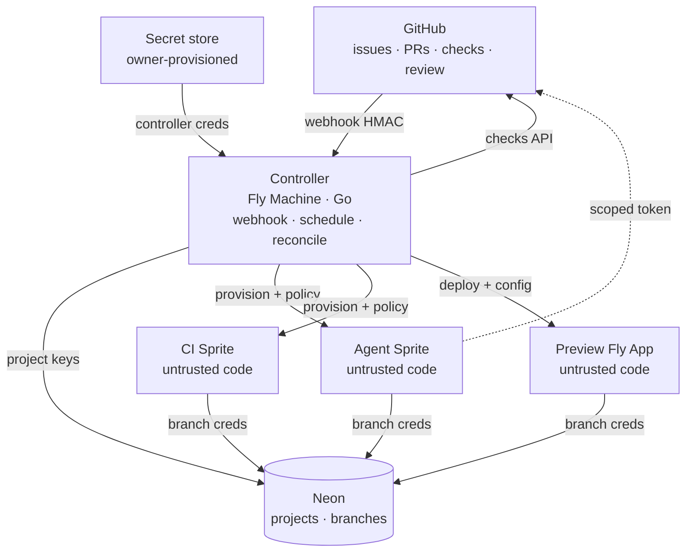
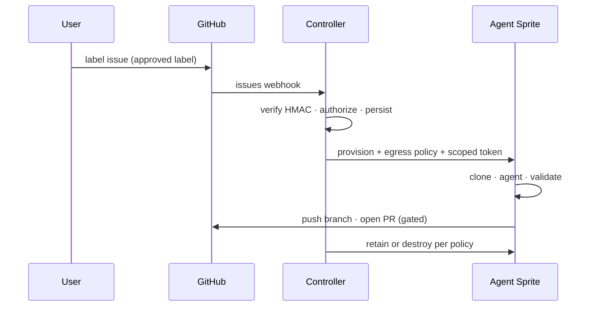
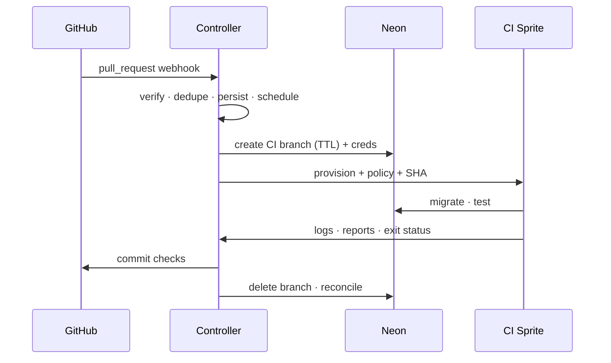
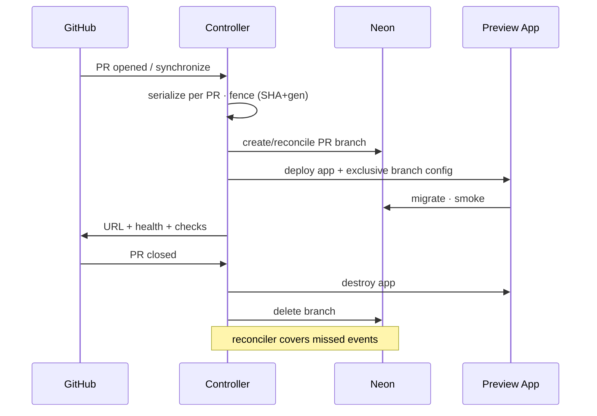

# Engineering lifecycle architecture — Miniapp Studio

**Status:** Stage 1 design (S1.6). **Sources:** prompt28.2 §2/§7/§8, prompt28.3, ADR-004–018.
**Principle:** Go defines behavior. Taskfiles declare workflows. Fly Machines coordinate. Fly Sprites isolate
execution. Neon holds all PostgreSQL. GitHub governs review. Developers get one-command flows; the platform absorbs
the complexity.

## Component and trust-boundary diagram

Trust boundaries: controller ≠ Sprites ≠ previews ≠ production. No boundary shares mutable workspace, credentials,
or database state. Connectors broker Sprite→GitHub API calls; the controller uses its own installation-token path
(ADR-011). Preview/agent/CI credentials can never reach production projects (ADR-005/010).

## Agent-execution sequence

## CI sequence

## Preview sequence

## Lifecycle state machines (summary; full tables in T-track plans)

- **Webhook delivery:** received → verified → deduped → persisted → acked → dispatched → completed | quarantined.
  Duplicates collapse at dedupe; unverifiable never persists.
- **CI execution:** scheduled → provisioning → running → reporting → done (pass/fail/cancelled) | orphan-reconciling.
  Persist-before-ack; leases bound worker ownership across restarts.
- **Agent execution:** triggered → eligible → provisioning → running → validating → PR-opened | draft-on-failure |
  stopped → retained | destroyed. Budgets checked pre-provision; heartbeats bound liveness.
- **Preview:** requested → provisioning → deploying → healthy | degraded → updating (fenced) → destroying → destroyed.
  One generation active; stale generations rejected, never applied.
- **Resource (each provisioned unit):** desired → creating → live → expiring → deleting → deleted | orphan (reconciler
  adopts). Destroy requires verified ownership metadata, never name match.

## Appendix — ADR coverage map (S1.5)

prompt28.2 §11 topics → ADR-007 (controller), 008 (sprite/checkpoint), 004+007 (CI database), 009 (per-PR isolation),
009 (naming), 018 (storage), 011 (GitHub App), 012 (webhook execution), 013 (expiration/cleanup), 014 (agent
concurrency/spend), 010 (security boundaries), 017 (protections/checks). prompt28.3 §10 topics → ADR-005 (project
boundaries), 005 (branch hierarchy), 005+006 (developer workflow), 007 (CI lifecycle), 009 (PR lifecycle), 016
(miniapp provisioning), 010 (credential inheritance/rotation), 015 (data strategy), 013 (quotas/costs), 013
(recovery/cleanup). No topic dropped; no duplicate records.
