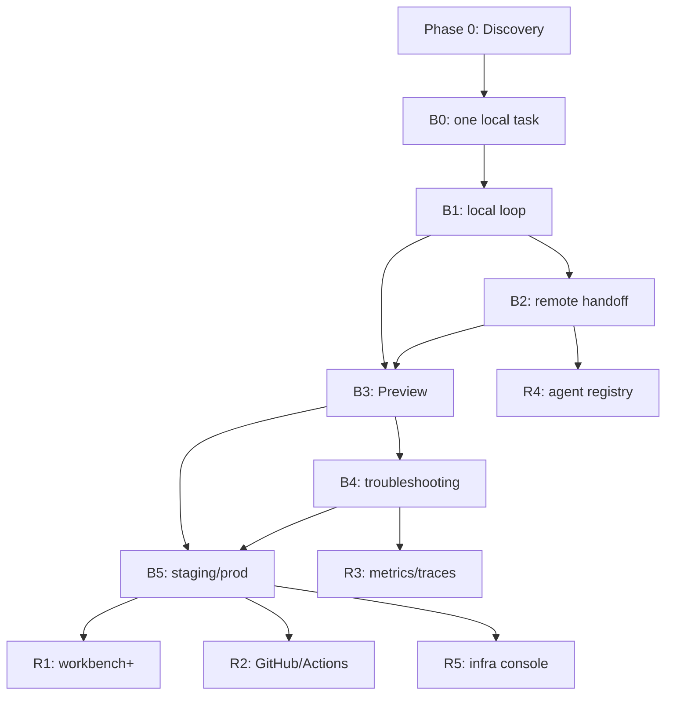
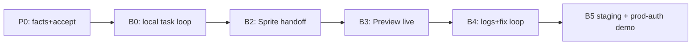

# Unified Lifecycle UI Implementation Plan — Miniapp Studio

- Status: PROPOSED (planning-only; no implementation authorized)
- Source prompt: `plans/prompt24.md` (base §1–10 + bootstrap revision + CLI amendment)
- Execution plan: `plans/prompt24_plan.md` (phases P0–P6)
- Research: workflow sweep 2026-11-26 (console-ui, backend, schema,
  docs-evidence, cli-discovery + synthesis); first-hand CLI
  corroboration by the author (flyctl 0.5.18, neon 9.9.3)
- Working-tree baseline: 69 modified/untracked entries preserved; this
  document is the single permitted new file
- Demo target: **Miniapp Studio developing itself** (local Muse
  workflow). Invoice Review Desk is superseded *as the demo*;
  its implementation evidence stands as fact (see §4).
- Rev 1 (prompt24_plan_review response): added the deployable-image
  provenance chain (§7.6), the minimum checkpoint prerequisite,
  and the P0 repository-integrity item. (Rev 1 used B1–B6 labels.)
- Rev 2 (owner GO): bootstrap phases renumbered B0–B5 to match
  SKILLS.md §14; B5 acceptance strengthened (migration
  set/checksum binding, per-Machine digest verification);
  `.agents/skills/` + `.mcp.json` recorded RETIRED per owner
  decision (P0 item 5 closed, §13 row 13).

Status vocabulary used throughout (exact meanings):

| Label | Meaning |
| ----- | ------- |
| implemented | Code + tests exist in the tree |
| implemented-but-not-integrated | Exists but not wired into the workflow |
| demonstrated-with-evidence | Shown green with filed evidence |
| planned | Designed here, not built |
| blocked-by-environment-or-permissions | Cannot proceed without env/auth |
| not-yet-tested | Built or proposed, no verification run |

---

## 1. Executive Summary

Miniapp Studio already owns most of a development control plane:
durable conversations/turns/questions (Phase A), the Focus Console
(Phase C), and artifact retrieval/verification/test/human-decision
(Phase D, D0–D5b evidenced, 17/17 suite green). What is missing is
the *unified lifecycle*: one journey from local development through
remote handoff, Preview, Staging, and Production, with environment
state, logs, and releases visible in the Console.

This plan breaks the chicken-and-egg problem by sequencing
**bootstrap-first**: build the minimum viable control plane that can
manage one real Studio development task (Bootstrap 0), then let each
successive increment (local loop → remote handoff → Preview →
troubleshooting → releases) be driven through Studio itself. The full
platform (workbench, GitHub/Actions, metrics/traces, agent registry,
infra console) follows as roadmap phases, never blocking the first
useful milestone.

Governing principle: **Studio must be useful before it is complete,
and every increment must make Studio more capable of developing
itself.** Manual execution steps are acceptable temporary bridges;
manual loss of development state is not.

Bootstrap questions (from the strategy revision), answered in order:

1. *Smallest end-to-end workflow on existing code?* Describe task →
   Studio prepares packet → local Muse executes (manual bridge) →
   result + tests returned → Studio evaluates evidence → human
   decides → lifecycle advances. All durable state fits existing
   tables plus one `builds.execution_location` column (B0).
2. *Reusable Phase A–D capabilities?* Conversations/builds/turns/
   questions, sender+ingest, artifact pipeline, approvals, stream/
   SSE, audit, Console scenes — reused unmodified; no second task
   engine, artifact system, or approval system (B4 ledger).
3. *Smallest schema delta?* Per-slice (§7.4): B0 one column; B1 one
   checkpoint table; B2 workspaces + handoff receipts; B3
   environments + releases; B4 bounded telemetry decision; B5
   approval binding. Nothing else until its slice needs it.
4. *Human-assisted bridges?* Muse invocation + result return (B0);
   agent-invoked CLIs under supervision until the Studio infra
   adapter exists (B3–B5 path).
5. *First genuine milestone?* B0 exit: one real Studio task managed
   end-to-end in Studio with history, evidence, and a recorded
   human decision.
6. *What comes next?* B1 local resume/progress, B2 remote handoff,
   B3 Preview, B4 troubleshooting, B5 releases (§10).
7. *Safely deferred?* Multi-agent registry, full GitHub PR
   management, metrics/traces, provider marketplace, infra
   console, workflow canvas (see §14).

## 2. Product Goal and Design Principles

**Goal:** one application, one continuous development journey, from
local development to production — develop, validate, deploy,
operate, and troubleshoot with environment state always visible.

**Binding principles (from prompt24 §2, preserved verbatim in
intent):**

- Studio is the web app and control plane; agents execute
  separately under Gateway supervision; each app has a dedicated
  Builder workspace; runtimes are separate from Studio/Builder.
- Miniapp exclusive framework/runtime; Go exclusive app language;
  MiniappSpec canonical; enforced at validation/admission/build/
  deploy boundaries, not by prompts.
- Studio's PG database is authoritative for process state;
  workspace files/processes are execution state, never the source
  of truth; runtime receives only the exact approved artifact.
- Agents cannot self-authorize; G-01 holds (synthetic data,
  simulated approval effects, no consequential external writes).
- **Two independent dimensions:** workspace execution location
  (Local Desktop | Remote Builder Sprite) vs application runtime
  environment (Local | Preview | Staging | Production) — separate
  controls, never one combined selector.
- Environment model: Desktop+local PG → Sprite+workspace DB →
  temp Fly Machine + ephemeral Neon branch → persistent Machine +
  staging branch → dedicated Machines + protected prod branch.
  No Preview→Production data promotion; schema migration ≠ data
  promotion; Preview uses sanitized/seed data only.
- One active execution owner; synchronized/unsynchronized/unsafe
  handoff states explicit; never silently discard uncommitted
  work or create two writers.
- Agent runtime ≠ model provider; no assumed matrix; demo uses
  local Muse only; no silent provider fallback ever.
- GitHub owns source/collaboration, Actions owns CI, Studio owns
  orchestration/verification/approval/release. Passing CI ≠
  Studio verified/approved.
- Focus Console is the foundation: 7-stage spine binding, no
  environment-as-stage, green only by inspectable persisted
  evidence, UI never the security boundary.
- **CLI amendment (binding):** installed Fly/Neon CLIs are
  first-class infra interfaces. Agent-invoked CLIs under
  supervision now; Studio-owned auditable infra adapter later.
  Operation classes (read-only → non-prod → staging →
  production → destructive) enforced server-side. No
  unrestricted shell tool. Discovered versions pin every
  command contract (flyctl 0.5.18, neon 9.9.3; Fly auth
  identity still unverified — Phase 0 exit item).

## 3. Current-State Repository Assessment

**Method:** static inspection of implementation + test bodies by five
research agents (31/59/32/21/28 tool calls), synthesis brief, plus
author first-hand corroboration of versions, migration count,
placeholder state, and security-critical CLI flags. Test DBs were
not executed during planning; cited gates come from filed evidence.

**Console (shipped):** gallery, spec, validate, connect (read-only),
run (builder-activity; product Run explicitly unproven), evidence
(artifact ledger + audit receipts), settings (minimal) —
`server/templates/focus/`, dispatch `server/handlers_console.go:19-32`.
**Placeholder:** deploy only (`scene_placeholder.html`, Phase E note).
Spine derivation `buildSpine` (handlers_console.go:40-117) with
Run-never-proven guardrail; Connect/Deploy pinned idle. Pulse kinds
approval/receipt/alert/event + SSE live append; Line composer with
qid reply mode and stale-409 handling. Auth: session-gated routes,
mutations +Origin, server-side tenant, opkey idempotency.

**Backend (shipped):** 27 registry tools (all ClassA/TrustAutonomous,
`tools/register.go:27-82`); operator-only DecideArtifact/
runArtifactTests/cancelAllBuilds deliberately unregistered.
Gateway HMAC protocol + commands + dedup/outbox/deliverer; Studio
sender (25-attempt backoff, reconcile, atomic settle); fetch_artifact
with digest/size/path verification; completion→verify hook in the
settle tx; studio-artifact/v1 contract (CheckSetVersion v1);
container test phase + conformance-on-green; digest-bound human
decide with replay-else-409; unified stream + SSE; dual-kind
approvals; secret scrubbing (documented non-exhaustive + one
disclosed framework-copy residual); Docker sandbox; gateway agent
isolation (separate UID, filedrop, 0600 KDF keys).

**Schema (shipped):** 22 migrations + paired downs, 19 studio tables,
composite (tenant,parent) CASCADE discipline, ENABLED+FORCED RLS on
all app tables, studio_app least-privilege + studio_app_test mirror
pinned by parity tests, additive fix-forward discipline.

**Docs/evidence:** D0–D5b filed with 16/16→17/17 gates; 23.1 verdict
(D5/D5b DONE, D6 not started, serial suite green); 3 ADRs (URL
topology, MPG PG17 + Neon fallback, deferred session proof);
contract frozen at studio-artifact/v1. No newer evidence supersedes
prompt24 §7. D6 abort residue: 1 claim, 7 queued/0 dispatched
fetches, 0 verified/runs/decisions/screenshots; must never be
cited as a demonstration.

**CLI (discovered, versions corroborated):** fly/flyctl 0.5.18 at
`~/.fly/bin`; neon 9.9.3 under nvm node. Neon identity verified
(owner OAuth, org on file); Fly auth state files present but
identity UNVERIFIED (sandbox blocked the check — re-verify in
Phase 0). Exact preview/staging/prod command surface recorded in
§7.5 from `--help` output; repo shells out to no CLI today
(SDK + direct REST only).

---

## 4. Existing Capabilities vs. Gaps

Capability ledger. Every "implemented" row cites inspected
implementation + test owners (paths below are evidence, not
proposals).

### 4.1 Console & workflow shell

| Capability | Status | Evidence |
| ---------- | ------ | -------- |
| 7-stage spine, zones, OPS/DEV, palette, a11y | implemented | plans/plan_ui.html, plans/plan_ui_z.md (locked :428-456); layout.html; console.js |
| Gallery / Spec / Validate scenes | implemented | scene_*.html; handlers_console.go; console_phased_test.go |
| Connect scene (read-only list) | implemented | scene_connect.html; ToolConnectorsList |
| Custom API wizard | planned | prototype plans/plan_ui.html:327-330 only |
| Deploy scene | placeholder | scene_placeholder.html (only one) |
| Run: builder activity | implemented | scene_run.html; dispatch/decisions/409 card |
| Run: product preview/health | planned | blocked-by-environment-or-permissions (needs Runtime) |
| Evidence: ledger + audit receipts | implemented | scene_evidence.html; ToolActivityList |
| G0–G12 gates table | planned | ledger+receipts shipped instead; gates never specified beyond prototype |
| Settings (tenant/binding/kill scope) | implemented | scene_settings.html (minimal) |
| Settings: env/infra rows | planned | prototype plans/plan_ui.html:401-407 only |
| Approval expiry countdown | planned | prototype-only, never shipped |
| Clarification card kind in Pulse | implemented-but-not-integrated | answered via run-scene reply buttons, not Pulse cards |
| Context bar (project/branch/CI/agent/workspace/env) | planned | §6.1 proposal |
| Developer Workbench | planned | §6.2 proposal |
| Per-app gallery cards/metrics | planned | no implementation |

### 4.2 Control-plane backend

| Capability | Status | Evidence |
| ---------- | ------ | -------- |
| 27 registry tools (spec/app/deploy/connectors/activity/conv/build/ingest/question/artifact) | implemented | tools/register.go:27-82; per-tool tests |
| Operator-only decide/test/kill (unregistered) | implemented | server/artifact_decide.go, artifact_testrun.go, console_stop.go |
| Gateway protocol + sender + reconcile | implemented | gateway/*.go; server/sender.go + sender tests |
| Claim→fetch→verify→test→decide + evidence rows | demonstrated-with-evidence | D0–D5b evidence; 17/17 suite |
| Unified stream + SSE + resume | implemented | store/stream.go; server/sse.go; resume tests |
| Dual-kind approvals (question authz + artifact) | implemented | tools/question.go; server/artifact_decide.go |
| Tenant isolation + RLS + parity tests | demonstrated-with-evidence | migrations; privilege_parity/rls_behavior tests |
| Secret scrubbing (write + read paths) | implemented | artifact/secrets.go; tools/scrub.go; 1 disclosed residual (app.invocations framework copy) |
| Docker sandbox (test phase) | demonstrated-with-evidence | sandbox/; daemon tests; 1 flake residual (timeout-cleanup) |
| deploy.* tools (Sprite-oriented) | implemented-but-not-integrated | tools/deploy.go; UI deploy placeholder; topology predates Machine/Neon model |
| Workspace/handoff model | planned | no tables; §7.3 proposal |
| Checkpoint/snapshot model | planned | turns are closest; no snapshot table |
| Environment/release model | planned | deployments is per-app singleton; §7.4 proposal |
| Infra adapter (CLI wrapper) | planned | no CLI shell-out exists; §7.5 + §8.4 proposal |
| Log ingestion/query/UI | planned | only sandbox run output exists; §5 workstreams |
| Metrics/traces | planned | nothing exists; readiness-gated (§10 R4) |
| GitHub repo/PR/Actions integration | planned | nothing exists (§10 R2) |
| Multi-agent/model registry | planned | explicitly deferred (§14) |

### 4.3 Demo-target resolution (author decision, evidence-backed)

Invoice Review Desk remains the P5 golden path in roadmap.md,
roadmap2, roadmap5 ("LOCKED"), the phase-d plan, and the hackathon
critical path — but plans/demo.md:20-24,39-65 explicitly SUPERSEDES
it with Studio-developing-itself (Muse), prompt23.1:5-17 bars any
Invoice rehearsal and redirects the next milestone to the
self-development redesign, and prompt24 §7 names Studio itself.
Newest accepted decision wins: **the demo target is Miniapp Studio
developing itself.** Invoice evidence stays valid as implementation
fact; roadmap5's "LOCKED" hackathon line is stale and must not gate
this plan. Lead-to-Booking stays a generality test only, never a
demo scope expansion.

---

## 5. Target User Journey

The dogfood journey: an owner develops Miniapp Studio through
Miniapp Studio. Stages reference the binding spine; bracketed tags
name the bootstrap slice that first makes each step real.

1. **Describe (B0).** Owner opens a conversation, states the task
   (objective, scope, acceptance criteria). Studio records it as a
   work item (build) with the repo/branch context attached.
2. **Task packet (B0).** Studio assembles the execution packet:
   instructions, context refs, evidence pointers, workspace
   identity. First via manual Muse bridge; the packet format is
   the stable contract that later automation fills.
3. **Execute + return (B0→B1).** Muse works locally; the attempt,
   git state, test output, and agent report return to Studio as
   evidence. B1 adds progress tracking and checkpoint resume.
4. **Review + decide (exists).** Validate scene shows verification
   and test evidence; the human approves/rejects the exact digest.
   Rejection returns a rework brief, never auto-continues.
5. **Handoff (B2).** Owner moves the workspace to a Remote Builder
   Sprite: preflight, snapshot+transfer, single-owner flip, durable
   receipt. Return path is symmetric. Sync states always visible.
6. **Preview (B3).** One verified artifact → isolated Neon branch +
   Fly Machine → URL + health in the Deploy scene. Same artifact
   digest everywhere; sanitized seed data only.
7. **Troubleshoot (B4).** Owner picks an error in Run/Preview,
   reads correlated real logs, builds a sanitized evidence bundle,
   asks the agent to investigate; the fix re-enters at step 1.
8. **Release (B5).** Promote the identical artifact Preview →
   Staging → Production, each with provenance, health checks,
   human digest-bound production approval, history, and rollback.

Troubleshooting loop detail (prompt24 §4.8) maps 1:1 onto steps
7→1→6→8; secrets/sanitization gates sit between log selection and
agent handoff (see §9).

---

## 6. Target UI Architecture

All UI extends the Focus Console. No new rails, no IDE, no canvas,
no dashboard-of-dashboards. Every addition renders authoritative
durable state or an honest empty/unavailable state.

### 6.1 Project context bar (planned, B0→B2)

One compact strip above the spine: project/repo, branch/PR/commit,
CI state (from B1 minimal git awareness; Actions dot in R2),
active agent + model, **workspace selector** (Local Desktop |
Remote Sprite + sync state), **environment selector** (Local |
Preview | Staging | Production) — two independent controls per §2.
Progressive disclosure: strip shows one-line state; click opens the
relevant scene/panel. Nothing here mutates; handoff/promote actions
live in their scenes with explicit confirmation.

### 6.2 Developer Workbench (planned, B1 slice → R1 full)

On-demand panel (not a rail, not a route): file browser, git
changes/branches/commits, agent tasks/sessions, test/build output,
workspace status, env-config visibility (never secrets). Terminal:
delegated to the owner's real terminal in B1 (Studio shows the
working directory + command receipts, never an embedded shell);
embedded terminal is a roadmap question, default no. Rule: the
workbench surfaces Studio-owned state; it never becomes a second
application.

### 6.3 Handoff UI (planned, B2)

Initiate from the workspace selector → preflight card (dirty tree
handling: commit/stash/include-in-snapshot — never silent discard)
→ progress with receipts → single-owner flip confirmation →
recovery/conflict cards on interruption. Remote→local is the same
flow reversed. Stale-state banners whenever the non-owning side is
shown.

### 6.4 Deploy scene → environment manager (planned, B3→B5)

Per-environment cards from persisted rows: identity/type, URL,
health/deployment state, commit + artifact digest, Machine id,
Neon branch id, migration status, last release, history.
Actions (explicit buttons + confirmations, never navigation
side-effects): create/refresh Preview, promote to Staging,
request/approve Production release (digest-bound human auth),
rollback. Spine: Deploy goes amber on activity, green only on a
verified live release receipt.

### 6.5 Run scene → operations workspace (planned, B4→R4)

Views: Overview / Logs / Metrics / Traces. **Logs first and fully
real** (filters: environment, deployment, service, severity,
request/correlation id, time range; live stream + reconnect).
Metrics/Traces render as honestly-unavailable panels until
collection exists — never fabricated. Run pill goes green only on
observed healthy telemetry for the focused environment, never on
agent claims.

### 6.6 Pulse and Line growth (planned, incremental B0→B5)

New Pulse event kinds (all via existing stream + unknown-kind
fallback): handoff receipts, git/CI updates, Neon branch
lifecycle, deployment/release events, operational alerts.
Line accepts context-aware commands ("preview this", "show logs
for…") with explicit confirmation for anything consequential;
agents never self-authorize releases or reach secrets via NL.

### 6.7 Settings (planned, B3→R5, capability-backed only)

AI/Agents (one agent first; registry deferred), Workspaces,
Environments, Infrastructure (Fly/Neon references, no secret
material), Observability (retention, sources), Security (policies,
audit). No setting without a backing capability.

---

## 7. Workspace and Environment Model

### 7.1 The two dimensions (binding)

| Dimension | Values | Owned by | UI control |
| --------- | ------ | -------- | ---------- |
| Workspace execution location | Local Desktop, Remote Builder Sprite | B2 workspaces table; before that, `builds.execution_location` | Workspace selector + sync state |
| Application runtime environment | Local, Preview, Staging, Production | B3 environments/releases tables | Environment selector |

A Remote Sprite may build for Preview; a local desktop may inspect
Production logs. The plan forbids any combined selector.

### 7.2 Environment model (target, from prompt24 §2.3)

| Environment | Compute | Database |
| ----------- | ------- | -------- |
| Local dev | Desktop Studio + local agent + local services | Local PG / dev database |
| Remote dev | Dedicated Fly Sprite | Workspace dev DB / controlled DB services |
| Preview | Temporary Fly Machine | Ephemeral Neon branch per candidate |
| Staging | Persistent Fly Machine | Persistent isolated Neon staging branch |
| Production | Dedicated Fly Machines | Protected production Neon branch |

Safety boundaries (non-negotiable): Machines ≠ Sprites; Preview
temporary/isolated; Staging persistent/shared pre-prod; Production
protected + explicit human release approval; no Preview→Prod data
promotion; schema migration ≠ data promotion; Preview seed data
sanitized/approved; Staging/Prod share no mutable state.

### 7.3 Handoff model (B2)

Durable concepts: workspace identity + location + single active
owner; snapshot references (content digests, not live processes);
uncommitted-change manifest (staged/unstaged/untracked + branch +
commits); conversation/turn checkpoint refs; agent/provider/session
context (resume handle where supported, reconstruction note where
not); task state; env config refs; test/verification refs;
artifact/evidence refs; handoff receipts + sync state
(synchronized | unsynchronized | unsafe). Live OS processes and
arbitrary provider sessions are explicitly NOT migratable; the UI
says what was resumed vs reconstructed.

### 7.4 Schema evolution (minimum viable contract per slice)

Rule: add a persistent concept only when the next usable increment
requires it. Reuse first: builds/turns (work item + slices),
commands (gateway attempts), artifacts+evidence rows, approvals,
deployments singleton.

| Slice | Proposed delta (proposal, not DDL) | Rationale |
| ----- | ---------------------------------- | --------- |
| B0 | `builds.execution_location` enum col (local_desktop default) | Distinguish manual-local attempts without a new engine; packet/result travel as messages/events |
| B1 | `checkpoints` table (id, tenant, build, turn, git ref+manifest digest, agent context JSONB, created) | Resume + progress need durable snapshots; turns alone cannot hold them |
| B2 | `workspaces` (id, tenant, app, location, owner, sync_state) + `handoffs` (id, workspace, from→to, snapshot refs, receipt, state) | Identity, single-owner enforcement, receipts |
| B3 | `app_environments` (app, env, neon_branch_ref, fly_app/machine_refs, url, health) + `environment_releases` (env, artifact digest, commit, migration state, receipt, history) | Per-env rows; deployments singleton cannot hold 4 envs × history |
| B4 | Bounded `telemetry_events` OR external Loki/store decision (open: §13) + `evidence_bundles` (sanitized, ref'd) | Logs need a store; PG-bounded keeps RLS story, external scales |
| B5 | `release_approvals` binding (env, digest, approver, op) or approvals-table extension | Production auth needs env+digest binding beyond artifact-only rows |
| R2+ | GitHub linkage cols/tables only when the slice lands | Nothing speculative |

Migration discipline (existing, keep): additive fix-forward,
paired mechanical downs, composite tenant FKs, ENABLED+FORCED RLS
+ grants + parity-test updates with every table. New tables must
extend TestPrivilegeParity and the test-role mirror or the phase
fails its gate.

### 7.5 CLI discovery (versions corroborated; contracts pinned)

| Area | Discovered fact (source) |
| ---- | ------------------------ |
| fly executable | `/home/chaschel/.fly/bin/fly`, `flyctl` same binary |
| fly version | `flyctl version 0.5.18` (author-observed) |
| fly surface | `apps` create/destroy/list/move/restart/releases; `machine` run/create/start/stop/restart/status/list/destroy/update/exec/kill/wait; `deploy [DIR] -a -c -i [--detach]`; `status -a [--deployment] [--watch] [-j]`; `logs -a [-m] [-r] [--json]` (streams; `--no-tail` for buffer); `secrets` deploy/import/list/set/sync/unset (list shows digests only); `orgs`, `auth` |
| fly auth state | UNVERIFIED: `auth whoami`/`orgs list` blocked in sandbox (flyctl wants `~/.fly` writes); `~/.fly/config.yml` (0600) implies prior login, contents never read. Phase 0 must verify outside the sandbox |
| neon executable | `/home/chaschel/.nvm/versions/node/v26.13.1/bin/neon` |
| neon version | `9.9.3` (author-observed) |
| neon surface | `projects` create/delete/get/list/recover/update; `branches` create/delete/get/list/rename/reset/restore/add-compute/set-default/set-expiration/schema-diff; `databases` create/delete/list; `roles` create/delete/get/list/reset-password; `connection-string [branch]`; `psql`; `logs` field-values/fields/loki/query (**no tail/stream verb**); `orgs`, `profile`, `api`. No `connections` group |
| neon auth state | Verified owner OAuth login + org on file; credential file name only (`~/.config/neonctl/credentials.json`), contents never read; `NEON_API_KEY`/profiles documented for non-interactive use |
| Security-critical | `neon branches create` defaults `--secrets=true` (prints credentials) — always pass `--no-secrets` (author-observed in `--help`) |
| Scoping | fly needs `-a/--app` or `-c/--config` (no repo fly.toml exists); neon needs `--project-id` or linked context (no repo .neon file) |
| Read vs mutate | Distinguishable by verb: list/get/status/logs/query vs create/delete/update/destroy/set/deploy/run/reset |
| Agent reachability | `neon me/orgs/profile` API reads work from the agent shell; authenticated fly commands unreachable in sandbox (config-dir writes); default tool shell is `/bin/sh`; no `FLY_*`/`NEON_*` token env vars set |
| Repo today | Zero CLI shell-out (SDK + direct REST only); any CLI use is new surface |

Lifecycle→CLI mapping (contracts to validate at implementation
against the pinned versions):

- Preview: `neon branches create --project-id … --name … --no-secrets [--expires-at …]` → image deploy (§7.6) → `fly status --deployment` + `fly logs -a …` → `neon branches delete` + machine destroy on cleanup.
- Staging: persistent branch + machine; same-image redeploy; migrations via controlled procedure (open: migrate-inside-release vs separate step, §13).
- Production: same, plus human digest-bound approval and `fly releases` history + rollback (redeploy prior release digest — validate exact mechanism in B5).

### 7.6 Deployable image provenance chain (binding; review item 1)

A verified Miniapp bundle is source, not a runnable. Promotion
moves exactly one immutable OCI image. The chain:

```text
Verified bundle (studio-artifact/v1, digest B)
  → image build (pinned Go toolchain + pinned base image, from B only)
  → OCI image (immutable digest I, provenance: B + toolchain + base + build receipt)
  → Preview Machine runs I → Staging Machine runs I → Production Machines run I
```

Rules:

- **Build once.** Exactly one image build per approved bundle
  digest. Never rebuild per environment. Where: B3 implements a
  deterministic Studio-side build step (Dockerfile + pinned base,
  hermetic inputs from the fetched bundle bytes); R2 may move the
  build into GitHub Actions with digest attestation, but the
  one-build rule and provenance record do not change.
- **Store by digest.** Push to one registry (recommendation: Fly's
  registry to keep the estate on one platform; GHCR is the named
  alternative — B3 records the choice with rationale). The release
  row references the image by immutable digest `I`, never by tag.
- **Verify at rest and at runtime.** After push, resolve and record
  `I`. After every deploy/promote, query the running Machine
  (`fly machine status --json` / `fly status --json`) and assert
  the running image digest equals `I`; mismatch fails the release.
- **Deploy by digest only.** The adapter allowlist contains image-
  pinned operations only (`fly deploy -i <digest>`, machine
  create/update to `<digest>`); source-path deploy forms are NOT
  allowlisted, so promotion cannot accidentally rebuild. The
  runner already anticipates this hook (`runner/register.go:18-20`:
  production releases stamp the OCI digest).
- **Provenance record.** Each release row binds: bundle digest B →
  image digest I → toolchain/base pins → build receipt →
  environment. Evidence scene shows the full chain.
- **ADR-001 note.** ADR-001 chose Sprite-per-app deployment *because*
  no image pipeline existed (`docs/architecture/decisions/
  001-url-topology.md`). This chain supersedes ADR-001's deployment
  mechanism for Preview/Staging/Production; Sprites remain remote
  *development* environments per §2. B3 records the supersession
  (amend ADR-001 status or add ADR-004 — B3 implementer proposes,
  owner accepts).

---

## 8. Target System Architecture and Data Flows

### 8.1 Component map

```text
Owner browser ──► Focus Console (Studio server-rendered; never executes infra)
                      │  ▲ Pulse/SSE
Studio server ────────┤  ├─► PG (authoritative: process, evidence, env state)
  ├─ registry tools   │  ├─► Gateway ──► Builder Sprite (agent runtime)
  ├─ operator-only ops│  ├─► Infra adapter ──► fly / neon CLIs ──► Machines / branches
  └─ telemetry ingest◄┘  └─► Runtime envs (approved artifact only)
Local Muse ◄── task packet / evidence return (manual bridge → API)
```

### 8.2 Data flows

1. **Dev loop:** Line → conversation/build → packet → Muse →
   evidence events → Validate → human decide. All durable in PG.
2. **Handoff:** preflight → snapshot refs → transfer → owner flip
   → receipt; builds continue addressing the same workspace id.
3. **Preview:** approved bundle digest → one image build (§7.6)
   → infra adapter (allowlisted op) → Neon branch + Machine →
   health + running-digest receipt → Deploy scene. Same image
   digest promoted Staging → Production; each hop records
   commit/bundle/image digests/migration/health/approver.
4. **Telemetry:** Miniapp slog emitter (A) → Studio collector (B)
   → bounded store → Run views + SSE; alerts → Pulse; audit stays
   in `app.audit_events`, never mixed with ops logs.
5. **Troubleshoot:** error → correlated logs → sanitized bundle →
   agent investigation → fix build → Preview verify → promote.

### 8.3 Reuse map (no second engines)

Conversations/builds/turns/questions/commands = work + attempts;
artifacts/evidence rows = verification+test proof; approvals =
human decisions (extended, not replaced, for releases);
stream/SSE/Pulse = all new event kinds; sender/outbox patterns =
infra-op execution state machine; scrubbing + sandbox + RLS =
unchanged foundations.

### 8.4 Infrastructure adapter (planned, B3→B5)

A controlled server-side CLI wrapper, NOT a shell service:
allowlisted operation contract, argument validation, environment
isolation, timeouts, output limits, credential redaction
(`--no-secrets` mandatory; digest-only secret reads), idempotency
keys, structured result records. Browser never executes infra;
DB never depends on parsed terminal output after the fact —
redacted transcripts are attachments to structured receipts.

---

## 9. Security and Authorization Model

Unchanged foundations: tenant isolation (RLS + server-side tenant,
no input tenant, no-existence-oracle 404s); session+Origin+opkey on
all console mutations; operator-only actions unregistered from the
agent manifest; agent cannot self-authorize; DEV never shows
secrets; F1/G-01 residuals carry forward (DB-held sessions until
owner decision; no consequential external writes).

### 9.1 Operation classes (CLI amendment, binding)

| Class | Examples | Authorization |
| ----- | -------- | ------------- |
| Read-only | list apps/Machines/branches, status, logs | Workspace/environment policy |
| Non-prod mutation | Preview branch/machine create/refresh/deploy | Explicit env-scoped permission + auditable execution |
| Staging mutation | Staging deploy/migrate/restart | Staging policy approval |
| Production mutation | Prod deploy/release/rollback/protected-DB change | Separate human authorization tied to op + target + digest |
| Destructive | Drop branch/DB, delete app/Machine/infra | Deny by default; exceptional auth + safeguards |

Enforcement lives in the server op layer + infra adapter. Prompts
and hidden buttons are not enforcement. Short-lived narrow creds
preferred; no silent fallback to broader creds or other envs.

### 9.2 Invariant → enforcement point

| Invariant | Enforced at |
| --------- | ----------- |
| Tenant isolation, no cross-tenant reads/writes | Database (RLS) + server (tenant ctx) |
| One active workspace owner; no split-brain | Database (owner col + tx flip) + server |
| Handoff never discards uncommitted work silently | Server (preflight gate) + UI (explicit choice) |
| Artifact immutability + digest provenance | Database (digest cols) + verify/decide re-hash + adapter (deploys pinned digest only) |
| One image per bundle; running digest equals release digest | Adapter (build-once, digest-pinned deploys) + server (runtime digest assertion per deploy) |
| Human approval bound to exact digest (+env for releases) | Server (decide/release tx) |
| Agent cannot authorize own work / release | Registry (unregistered ops) + server (binding-as-decider) |
| Secrets never in logs/plans/transcripts/agent ctx | Adapter (`--no-secrets`, redaction) + scrubbing + UI (DEV rules) |
| Runtime isolated from Builder/agent/Gateway/creds | Deployment boundary (artifact-only runtime) |
| Neon branch isolation + lifecycle cleanup | Adapter (per-env refs, expiry, cleanup policy) + server (state machine) |
| Migration vs data promotion separated | Server (distinct procedures) + adapter (distinct ops) |
| Telemetry honesty: no fabricated logs/metrics | Server (ingest only) + UI (honest-unavailable panels) |
| SSE/stream resume without loss/dupes | Database (append-only seq) + server (cursor protocol) |
| Idempotent retries, no double effects | Database (dedup keys, opkeys) + sender/adapter state machines |
| Crash/restart recovery to durable state | Database (rows) + sweep-on-start (sender precedent) |

### 9.3 Credential architecture

Local: owner CLI auth stays in owner stores; agent invokes CLIs
under supervision with documented PATH/auth/cwd/redaction rules.
Remote Sprite: separately authorized auth (no copied credential
stores, no raw secrets in transfer); per-environment scoping so a
local session is never implicit prod authority. Production creds
isolated from dev execution; prefer short-lived narrow tokens
where the CLIs support them (validate in B5).

---

## 10. Phased Implementation Roadmap

Sequencing rule: bootstrap slices first (each exits with Studio
able to drive more of itself), roadmap phases after. A phase may
start when its prerequisites are *demonstrated-with-evidence*, not
when code merely exists.



Demo-critical path (narrow): P0 → B0 → B2 → B3 → B4 → B5(partial:
staging + prod-auth-boundary demo). B1's checkpoint core is a
hard B2 prerequisite (defined in B2); only B1's workbench slice
folds or slips. R-phases excluded. See §11.

### Phase 0 — Discovery & architecture reconciliation (S)

- Objective: close every unknown this plan marks unknown before
  building on it.
- User-visible outcome: none (planning artifact + verified facts).
- Scope: verify Fly auth identity outside sandbox; confirm Neon
  project/org for rehearsal use; confirm Muse invocation path +
  output capture; decide telemetry store (bounded PG vs external);
  decide migration-inside-release vs separate step;
  record the `.agents/skills/` + `.mcp.json` retirement (review
  item 3 — owner decision: RETIRED, no reconstruction; closed
  Rev 2); accept doc.
- Exclusions: any implementation, any cloud mutation.
- Reuse: this document's §3/§4/§7.5 evidence.
- Areas: none (docs + read-only probes).
- Data/API/protocol: none.
- Dependencies: owner availability for auth checks.
- Security: read-only probes; redact everything by default.
- Failure/recovery: N/A (no state changed).
- Tests: checklist execution, each item evidenced or marked unknown.
- Acceptance: (1) Fly identity recorded from `auth whoami` output;
  (2) Neon project id recorded; (3) Muse bridge procedure written;
  (4) telemetry-store + migration-step decisions recorded with
  rationale; (5) `.agents/skills/` + `.mcp.json` retirement
  recorded (owner decision, Rev 2 — no reconstruction);
  (6) owner accepts this plan.
- Evidence: amended §7.5 rows + decision log entries.
- Risks: Fly org access missing → B3 blocked (env/auth).
- Complexity: S. Blocking deps/exit: all six acceptance items.

### B0 — Studio manages one local task (M) [FIRST USEFUL MILESTONE]

- Objective: one project, one local workspace, one Muse
  workflow, fully tracked in Studio with human decision.
- User-visible outcome: describe a Studio task in the Console →
  execution packet shown → run Muse locally (manual bridge) →
  return result → evidence evaluated → human accepts/rejects/
  reworks. History browsable in gallery/Pulse/Evidence.
- Scope: task packet format (instructions/context/refs/workspace
  id); manual-bridge procedure doc + Console affordances (packet
  view, result-return form capturing git state/tests/report);
  `builds.execution_location`; context bar v0 (project/branch/
  agent/workspace — env selector present, Local only).
- Exclusions: automation of agent launch; checkpoints/resume;
  remote; Preview; workbench panel; GitHub.
- Reuse: conversations/builds/turns/questions, messages/events,
  Validate/decide flows, stream/SSE/Pulse, audit — unmodified.
- Areas: `tools/` (packet/read APIs), `server/` console handlers
  + templates, migration 000023 (one column), docs (bridge runbook).
- Data/API/protocol: +`builds.execution_location`; packet/result
  as message/event payloads (convention, no new tables).
- Dependencies: P0 (Muse bridge procedure).
- Security: tenant + session/Origin/opkey as today; packet
  contains refs not secrets; result ingest scrubbed.
- Failure/recovery: bridge interruption leaves build open with
  partial evidence; resume = new attempt referencing prior.
- Tests: packet round-trip; result return incl. dirty-tree note;
  isolation (tenant B sees nothing); replay/idempotency of the
  return form; full suite green.
- Acceptance: (1) a real Studio task runs end-to-end through the
  Console with zero out-of-Studio state; (2) Evidence shows the
  attempt + tests + decision; (3) second attempt after rejection
  links its parent.
- Evidence: task id + screenshots/exports + suite log.
- Risks: packet format churn (mitigate: version the packet).
- Complexity: M. Blocking deps/exit: acceptance 1–3 + suite green.

### B1 — Local loop: progress, checkpoints, git awareness (M)

- Objective: Studio coordinates local execution with resume and
  minimal git truth.
- User-visible outcome: progress visible per attempt; resume from
  checkpoint after interruption; branch/dirty-state/commit shown in
  context bar and workbench slice; test/build output attached.
- Scope: `checkpoints` table + write/read APIs; minimal git
  awareness (branch, status porcelain digest, commit SHAs as refs —
  Git stays source of truth); workbench slice (files read-only
  list, git panel, output viewer; terminal delegated).
- Exclusions: remote; auto-launch; PR management; Actions.
- Reuse: turns (slices) + events + artifacts for evidence.
- Areas: `tools/`, `store/migrations` (000024), console
  context-bar/workbench templates + JS, checkpoint helpers.
- Data/API/protocol: +`checkpoints`; git data by reference
  (SHAs/digests), never file copies in PG.
- Dependencies: B0 demonstrated.
- Security: checkpoint JSONB scrubbed; git refs only (no blobs);
  same tenant/auth stack.
- Failure/recovery: checkpoint write atomic with attempt state;
  resume from latest complete checkpoint; interrupted attempt
  marked, never silently dropped.
- Tests: checkpoint round-trip; resume-after-kill; dirty-tree
  manifest accuracy; cross-tenant checkpoint invisibility.
- Acceptance: (1) kill mid-attempt → resume continues from the
  checkpoint with no lost context; (2) context bar git state
  matches `git status` at checkpoint time; (3) suite green.
- Evidence: checkpoint rows + resume demo + suite log.
- Risks: snapshot size creep (mitigate: refs + caps, no blobs).
- Complexity: M. Blocking deps/exit: acceptance 1–3.

### B2 — Remote handoff to Builder Sprite (L)

- Objective: move a workspace local↔remote with continuity and
  exactly one owner.
- User-visible outcome: workspace selector initiates handoff →
  preflight → progress → receipt; work continues on the Sprite;
  return path symmetric; sync/stale states always shown.
- Scope: `workspaces` + `handoffs` tables; preflight checks;
  snapshot+manifest transfer; owner flip tx; receipt + Pulse
  events; Sprite-side CLI/auth strategy (separate auth, §9.3);
  agent resume-or-reconstruct with visible labeling.
- Exclusions: multi-Sprite fleets; live process migration;
  provider-native session guarantees; Preview.
- Reuse: build.provision/upgrade, Gateway protocol, sender
  patterns, checkpoints (B1), scrubbing.
- Areas: `tools/`, `gateway/` (transfer/collector reuse),
  `server/` console, migrations (000025), Sprite setup docs.
- Data/API/protocol: +`workspaces`, +`handoffs`; transfer over
  existing Gateway transport (new command only if evidence
  demands; prefer fetch/collector reuse).
- Dependencies: B1-checkpoint-core demonstrated (see below);
  Sprite org access (owner).
- Minimum B1 prerequisite for B2 (binding; review item 2): the
  `checkpoints` write/read APIs, the git manifest convention
  (branch + status digest + SHAs), and one demonstrated
  resume-after-kill. The B1 workbench slice (file list, git
  panel, output viewer) may fold into B0/B2 or slip to R1, but
  B2 starts only after the checkpoint core above is
  demonstrated-with-evidence. Demo path (§11) uses B2 on this
  pruned prerequisite, never on zero checkpoints.
- Security: single-owner tx; no credential-store copying; remote
  auth separately authorized + env-scoped; transfer integrity
  via digests; preflight refuses silent-discard.
- Failure/recovery: interrupted handoff leaves explicit
  unsynchronized/unsafe state + recovery card; conflicts surface
  file lists, never auto-merge uncommitted work.
- Tests: handoff happy path + kill-mid-transfer recovery +
  double-owner refusal (concurrent flips, one winner) +
  dirty-tree variants + return path; suite green.
- Acceptance: (1) real task handed local→Sprite→local with zero
  lost changes and continuous history; (2) at no point are both
  sides writable; (3) receipt + Pulse trail complete.
- Evidence: handoff rows + receipts + suite log.
- Risks: Sprite networking/auth setup (owner-gated); transfer
  size (caps + chunking).
- Complexity: L. Blocking deps/exit: acceptance 1–3 + Sprite
  access confirmed.

### B3 — Preview lifecycle, CLI-driven (L)

- Objective: one verified artifact → isolated Neon branch + Fly
  Machine → URL + health, all Studio-recorded.
- User-visible outcome: Deploy scene shows the Preview env card
  (URL, commit, digest, Machine, branch, migration, health);
  create/refresh from the Console; cleanup removes branch and
  Machine per policy.
- Scope: `app_environments` + `environment_releases` tables;
  image build + push + provenance record (§7.6); infra adapter
  v0 (allowlisted Preview ops only, image-pinned deploys only);
  Neon branch create/delete + seed; Machine run/deploy/status/
  logs/health; running-digest verification; cleanup policy +
  execution.
- Exclusions: staging/prod; auto-preview-per-PR; migration
  framework beyond the controlled procedure.
- Reuse: artifact pipeline (verified digest in, nothing else);
  approvals for Preview authorization; stream/Pulse receipts;
  scrubbing (`--no-secrets` mandatory).
- Areas: new `infra/` adapter package, `tools/` env ops,
  Deploy scene templates/handlers, migrations (000026).
- Data/API/protocol: +env tables; CLI contracts pinned to
  flyctl 0.5.18 / neon 9.9.3 (§7.5), validated at build time.
- Dependencies: B1 (local) + B2 (remote path proved; Preview
  may build from either); P0 Fly/Neon access.
- Security: non-prod mutation class; adapter allowlist +
  redaction + timeouts; seed data sanitized; branch expiry;
  no creds in receipts (digests/refs only).
- Failure/recovery: op state machine (requested→running→
  verified/failed) with reconcile; partial create (branch
  without Machine) converges or rolls back explicitly;
  cleanup failures stay visible, never silent.
- Tests: adapter contract tests with recorded CLI fixtures
  (no live calls in unit tests); live Preview create/verify/
  destroy rehearsal (separately authorized); idempotent
  re-run; tenant isolation of env rows.
- Acceptance: (1) one image build per bundle digest, provenance
  row binds B→I→toolchain/base; (2) Console Preview create → live
  URL serving image `I`, and queried running digest equals `I`;
  (3) health + branch + Machine visible; (4) cleanup removes all
  Preview resources (verified by list commands); (5) source-path
  deploy forms absent from the adapter (negative test);
  (6) suite green.
- Evidence: release + provenance rows + CLI receipts + running-
  digest checks + suite log.
- Risks: CLI version drift (mitigate: version assertion at
  adapter start); Fly/Neon outages (honest degraded states);
  registry choice (record with rationale; default Fly registry).
- Complexity: L. Blocking deps/exit: acceptance 1–6 + live
  rehearsal authorization + ADR-001 supersession recorded.

### B4 — Troubleshooting + real logs (L)

- Objective: error → logs → sanitized bundle → agent fix →
  Preview verify, all inside Studio.
- User-visible outcome: Run scene Logs view with filters + live
  tail; error selection shows correlated request/deployment/
  commit; one-click sanitized evidence bundle; fix task created
  from the bundle; Metrics/Traces panels honestly unavailable.
- Scope: Workstream A (Miniapp slog emitter: timestamp/severity/
  app/env/deployment/request ids + scrubbing + OTel path) and B
  (Studio collect/ingest/store/query/stream/retention + UI);
  `evidence_bundles` (+ `telemetry_events` iff P0 chose PG);
  sanitization gate before any agent handoff.
- Exclusions: metrics/traces collection (R3); cross-env log
  join; prod-data access by agents (forbidden, not deferred).
- Reuse: stream/SSE/Pulse patterns; scrubbing; artifact decide
  flows for the fix build; adapter log-read ops.
- Areas: miniapp framework (emitter — separate repo/process!),
  new Studio telemetry package, Run templates/handlers,
  migration (000027).
- Data/API/protocol: log envelope contract (versioned);
  ingest API (authenticated, env-scoped); retention policy rows.
- Dependencies: B3 (something real to observe); framework
  emitter lands before Studio ingest goes live.
- Security: prod logs readable by owner, never shipped raw to
  agents; bundle builder allowlists fields + scrubs; ingest
  authenticated per env; retention deletes verifiably.
- Failure/recovery: ingest backpressure → bounded drop with
  visible gap markers (never silent); collector crash resumes
  from cursor; store-full refuses with operator alert.
- Tests: emitter golden tests; ingest fuzz + backpressure;
  bundle sanitization negatives (secret canaries never pass);
  unavailable-panel tests; suite green.
- Acceptance: (1) real Preview error traced to request logs in
  the Console; (2) bundle contains zero secret spans under
  canary test; (3) fix build → Preview verify closes the loop;
  (4) Metrics/Traces show unavailable, not zeros.
- Evidence: telemetry rows + bundle samples (redacted) + demo.
- Risks: framework repo coordination (separate owner/process);
  log volume (retention + sampling policy).
- Complexity: L. Blocking deps/exit: A+B both live + 1–4.

### B5 — Staging + Production releases (L)

- Objective: promote the identical artifact with provenance,
  approvals, health gates, history, and rollback.
- User-visible outcome: Deploy scene staging/prod cards; promote
  buttons with confirmations; production requires explicit human
  digest-bound approval; release history + rollback per env.
- Scope: adapter staging/prod ops (image-pinned only, §7.6);
  `release_approvals` binding (image digest + target env +
  exact migration set/checksums); migration procedure (per P0
  decision); health + per-Machine running-digest verification;
  rollback (prior image-digest redeploy; mechanism validated);
  promotion guards (same image digest, Preview-verified first).
- Exclusions: auto-promotion; blue/green beyond redeploy;
  multi-region.
- Reuse: B3 env tables + adapter skeleton; approvals model;
  audit; Pulse release events.
- Areas: `infra/`, `tools/`, Deploy templates, migration (000028).
- Data/API/protocol: +release approval binding; release rows
  link artifact digest + commit + migration receipt.
- Dependencies: B3 + B4 demonstrated; owner prod authorization;
  P0 migration-step decision.
- Security: staging/prod/destructive classes enforced in
  adapter; prod creds isolated; no agent path to prod mutation;
  rollback is itself a prod-class op (human-authorized).
- Failure/recovery: failed release keeps prior version live +
  visible failed receipt; rollback verified by health check;
  partial migration handled by the P0-chosen procedure only.
- Tests: promotion-guard negatives (wrong digest refused,
  unverified refused); approval-binding tests; rollback
  rehearsal on staging; prod paths tested against fixtures +
  separately-authorized live staging only.
- Acceptance: (1) same image digest Preview→Staging→
  Production with unbroken B→I provenance; every deployed
  Machine's running digest queried and equal to the release
  digest (no sampling); (2) prod approval binds image digest +
  target env + exact migration set/checksums, and prod release
  without that human approval is impossible (negative tests
  for digest mismatch, env mismatch, and migration-set
  mismatch); (3) rollback restores prior image digest verified
  by health + per-Machine digest query; (4) suite green.
- Evidence: release + approval + provenance rows + per-Machine
  digest checks + health receipts.
- Risks: prod authorization process (owner-defined); migration
  edge cases (staging-first rule).
- Complexity: L. Blocking deps/exit: acceptance 1–4 + prod auth.

### R1 — Full workbench + console deltas (M)

- Objective: complete the B1 workbench slice + close shipped-vs-
  prototype console gaps worth closing.
- User-visible outcome: full workbench panel; clarification Pulse
  cards; approval expiry display; Custom API wizard; settings env
  rows; per-app gallery info.
- Scope: workbench file/git/output completion; Pulse card kind;
  wizard (Define→Test→Scope, secrets memory-only per existing
  connectors precedent); settings rows backed by B3/B5 state.
- Exclusions: embedded terminal (default no); G0–G12 gates (only
  if specified — currently unspecified beyond prototype).
- Reuse: Connect scene, connectors attest flow, Pulse/SSE.
- Areas: `server/` console + templates + JS.
- Data/API/protocol: none new expected (reads existing rows).
- Dependencies: B5 (env state to display).
- Security: wizard secrets never persisted (existing precedent);
  same console auth stack.
- Failure/recovery: standard scene error/empty states.
- Tests: scene tests per addition; a11y + OPS/DEV parity.
- Acceptance: each addition renders real state or honest empty;
  suite green.
- Evidence: scene screenshots + tests.
- Risks: scope creep into IDE (mitigate: §6.2 rule).
- Complexity: M. Blocking deps/exit: acceptance + review.

### R2 — GitHub repo/PR/Actions integration (L)

- Objective: branch/diff/PR/CI visibility + required-check
  policies + commit→artifact provenance.
- User-visible outcome: context bar + workbench show branch/PR/
  Actions status; Preview ties to exact commit+artifact; policies
  gate promotion (advisory until enforced — explicit).
- Scope: repo connection (GitHub App, least privilege,
  short-lived creds); read APIs (branches, PRs, Actions
  runs/jobs/logs); required-check policy rows + evaluation;
  provenance links (commit↔build↔artifact↔release).
- Exclusions: PR creation/merge from Studio; write access beyond
  scoped minimum; replacing GitHub reviews.
- Reuse: existing git-ref conventions; stream/Pulse events;
  approvals for policy overrides (human).
- Areas: new `github/` client package, `tools/`, console UI,
  migration for linkage/policy rows.
- Data/API/protocol: linkage + policy tables; GitHub REST/SSH
  contracts versioned; webhook handling if needed (HMAC).
- Dependencies: B5; owner GitHub App approval.
- Security: least-privilege App perms; short-lived tokens server-
  side only; token expiry handled, never broadened silently.
- Failure/recovery: API outage → stale banners with timestamps;
  webhook loss → reconcile on poll.
- Tests: recorded-fixture contract tests; policy evaluation
  matrix; stale-state UI tests; live read-only rehearsal.
- Acceptance: (1) PR + CI state visible and fresh-dated;
  (2) policy blocks promotion on red checks (when enforced);
  (3) provenance chain complete for one release.
- Evidence: linkage rows + UI + rehearsal log.
- Risks: GitHub API change (contract tests); permission creep.
- Complexity: L. Blocking deps/exit: acceptance + App approval.

### R3 — Metrics + tracing (L)

- Objective: turn the honestly-unavailable panels real, with
  readiness gates per signal.
- User-visible outcome: Run Metrics/Traces views with real data
  where collection exists; per-signal availability states.
- Scope: workstream A metric/span emission; workstream B
  collection/store/query/UI; readiness gate checklist per signal
  (emitted → collected → queryable → displayed).
- Exclusions: APM-parity breadth; custom dashboards v1.
- Reuse: B4 telemetry pipeline + store decision.
- Areas: framework emitter + Studio telemetry + Run UI.
- Data/API/protocol: metric/span envelope extensions (versioned).
- Dependencies: B4; framework coordination.
- Security: same as B4 (no agent raw access; retention).
- Failure/recovery: per-signal degrade with visible states.
- Tests: golden emission tests; gate-transition tests; no-
  fabrication tests (unavailable ≠ zeros).
- Acceptance: each claimed signal passes its gate with live data.
- Evidence: gate checklist + live captures.
- Risks: cardinality/volume (sampling + retention policy).
- Complexity: L. Blocking deps/exit: gates green.

### R4 — Agent/provider registry (M)

- Objective: grow from one agent to a governed set without
  rebuilding the loop.
- User-visible outcome: settings list of allowed runtimes +
  workspace defaults + per-build overrides (authorized);
  immutable execution snapshots; no silent fallback, ever.
- Scope: allowlist tables; per-build override flow; snapshot
  persisted per attempt; matrix validation (runtime×provider).
- Exclusions: auto-selecting providers; prompt marketplace.
- Reuse: B0 packet (extends with snapshot ref); checkpoints.
- Areas: `tools/`, settings UI, migration for registry rows.
- Data/API/protocol: registry + snapshot tables.
- Dependencies: B2 (multi-runtime need proven).
- Security: credentials server-side encrypted; snapshot
  immutable; override requires authorization.
- Failure/recovery: unknown runtime/provider refused loudly.
- Tests: matrix tests; fallback-refusal tests; snapshot
  immutability tests.
- Acceptance: two runtimes governed; silent fallback
  negatively tested; suite green.
- Evidence: registry rows + matrix results.
- Risks: combinatorial testing (cap the matrix explicitly).
- Complexity: M. Blocking deps/exit: acceptance.

### R5 — Infra console + settings completion (M)

- Objective: operate Fly/Neon estates from Studio without
  leaving the Console for routine reads.
- User-visible outcome: infrastructure settings views (apps,
  Machines, branches, status, history); routine read ops;
  all mutations still via adapter classes + approvals.
- Scope: read-surface completion; cleanup-policy management;
  cost/usage visibility if the CLIs expose it (else omit).
- Exclusions: reimplementing fly/neon dashboards; fleet/quota/
  billing subsystems (no evidence of need).
- Reuse: adapter read ops; Deploy scene state.
- Areas: `server/` console + `infra/` reads.
- Data/API/protocol: none new (reads + cached state).
- Dependencies: B5.
- Security: read-only class; no credential display.
- Failure/recovery: CLI/API outage → stale banners.
- Tests: read-path tests; stale-state tests.
- Acceptance: routine reads available; mutations unchanged.
- Evidence: views + tests.
- Risks: CLI surface churn (pin + assert versions).
- Complexity: M. Blocking deps/exit: acceptance.

---

## 11. Hackathon/Demo-Critical Path

Narrow sequence (R-phases excluded; B1's checkpoint core is a
hard B2 prerequisite per §10 — only its workbench slice folds):



Demo script (each step evidenced live, nothing pre-baked):

1. Studio running locally; owner describes a real Studio task.
2. Local Muse executes via the B0 bridge; evidence returns.
3. Human decides in Validate; history visible in Evidence.
4. Handoff to Remote Builder Sprite with receipt; continue there.
5. Preview: Neon branch + Fly Machine + URL; health shown.
6. Real log inspection; sanitized bundle; agent fix; re-verify.
7. Promote same digest to Staging; demonstrate the production
   approval boundary (auth refusal without human approval +
   approval flow) — full prod release only if B5 acceptance 1–4
   holds; otherwise the boundary demo IS the prod story.

Demo integrity rules: every claim backed by a live row/URL/log;
pre-recorded output labeled as such; mocks never presented as
integration; the D6 abort is never cited as success.

---

## 12. End-to-End Acceptance and Rehearsal Plan

Per-phase gates (§10) plus three joint rehearsals, each separately
authorized for its live-resource scope:

1. **Loop rehearsal (B0–B2):** one task local → handoff → return →
   decide, no cloud mutations. Pass = zero lost state + receipts.
2. **Preview rehearsal (B3–B4):** Preview create → logs → fix →
   re-verify → destroy. Pass = exact-digest serving + clean
   teardown verified by list commands.
3. **Release rehearsal (B5):** staging promote → prod-approval
   boundary (negative + positive) → rollback on staging.
   Pass = provenance unbroken + rollback verified.

Rehearsal evidence standard: named rows/URLs/receipts, CLI
transcripts redacted, suite green before and after, teardown
verified. A rehearsal that skips teardown fails.

---

## 13. Risks, Dependencies, and Open Decisions

| # | Risk / decision | Impact | Mitigation / owner |
| - | --------------- | ------ | ------------------ |
| 1 | Fly auth identity unverified | B3 blocked | P0: verify outside sandbox (owner) |
| 2 | Telemetry store undecided (PG vs external) | B4 shape | P0 decision with volume math |
| 3 | Migration-inside-release vs separate step | B5 procedure | P0 decision; staging-first either way |
| 4 | Framework emitter coordination (separate repo) | B4/R3 schedule | Early workstream-A agreement; Studio side mockable via contract tests |
| 5 | CLI version drift (0.5.18 / 9.9.3 pinned) | Adapter breakage | Version assertion at adapter start; contract re-validation per release |
| 6 | Sprite networking/auth setup | B2 schedule | Owner-gated; separate-auth design (§9.3) |
| 7 | Neon has no streaming tail (query/loki only) | Live-tail UX | Poll-based live view or Fly-side logs; decide in B4 |
| 8 | Transfer/snapshot/log volume | Perf/cost | Refs+digests, caps, retention/sampling policy |
| 9 | F1/G-01/P-G0 residuals | Inherited constraints | Carried; owner decisions unchanged |
| 10 | Timeout-cleanup flake (D3) | Suite noise | Documented residual; any red still fails gates |
| 11 | roadmap5 "LOCKED" staleness | Conflicting demo claims | This plan supersedes for demo scope (§4.3) |
| 12 | Scope creep into IDE/platform breadth | Schedule | §6.2 rule + §14 non-goals enforced at review |
| 13 | `.agents/skills/` + `.mcp.json` retired per owner decision (Rev 2); session audit excluded agent cause; no repo-side recovery existed | Closed, no action | `.agents/memory/` verified intact; do not recreate without a new owner decision |

---

## 14. Explicit Non-Goals

- Multi-agent/model registry before R4; provider marketplace ever
  (no evidence).
- Full GitHub PR management (visibility + policies only, R2).
- Metrics/traces before readiness gates (R3); fabricated
  telemetry ever.
- Generic workflow canvas; fleet/quota/billing subsystems.
- Embedded terminal (delegated; default no).
- Auto-promotion; blue/green beyond redeploy; multi-region.
- Live OS process or provider-session migration (reconstruct +
  label instead).
- Second task/artifact/approval engines (reuse is mandatory).
- Production data in agent context (forbidden, not deferred).

---

## 15. Definition of Done

The program is done when:

1. Every B-phase meets its §10 acceptance with filed evidence.
2. All three §12 rehearsals pass with teardown verified.
3. The demo script (§11) runs end-to-end on Studio itself.
4. Full suite green; parity/RLS gates extended to every new table.
5. No unresolved P0 items; all §13 decisions recorded.
6. No mock presented as integration anywhere in demos or docs.
7. R-phases either done per their gates or explicitly deferred
   with rationale — never silently dropped.

*End of plan. Awaiting architectural review and implementation
authorization. No implementation was performed to produce this
document.*
