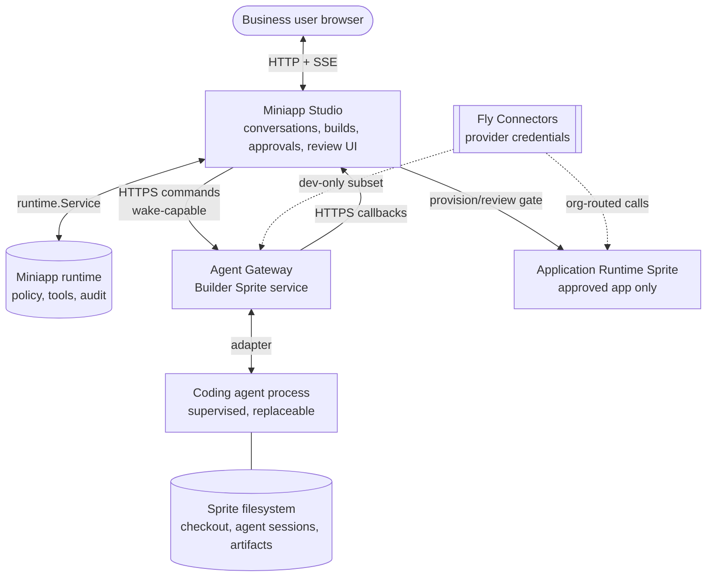
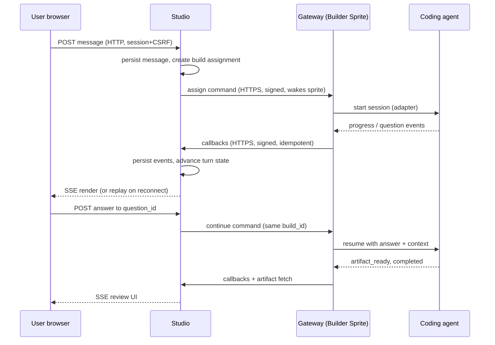
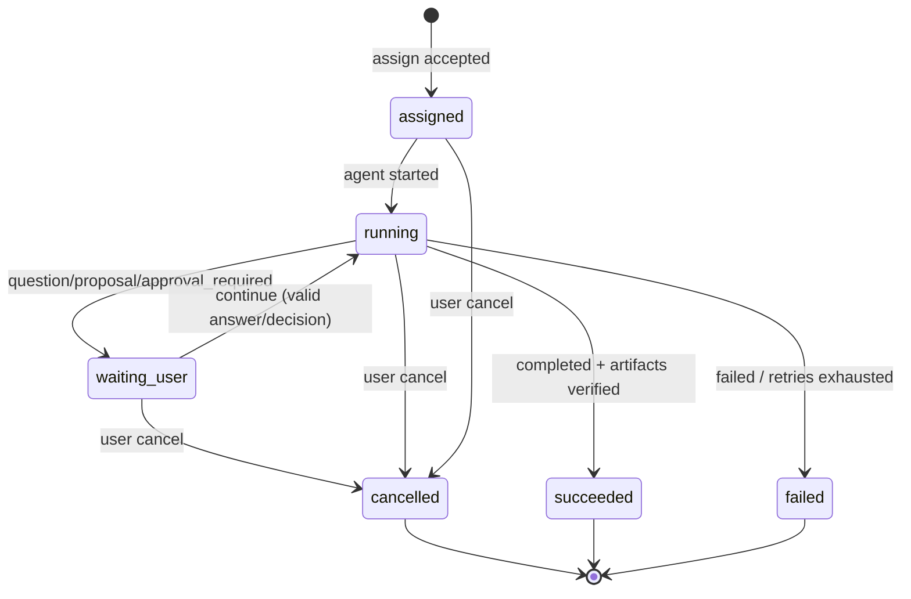

# Miniapp Studio Agent Gateway — Implementation Plan

**Status:** Proposed 2026-11-24; OpenCode amendment merged 2026-11-24
(owner-approved, see Appendix: changelog). **Scope:** planning only; no
code, migrations, provisioning, commits, or pushes were performed to
produce it. Source prompt: `plans/prompt_roadmap3.md`. Context:
`plans/roadmap3.md` (Lead-to-Booking), `plans/sprites.md` (Sprite
operating facts), `plans/prompt_opencode.md` (OpenCode designation —
merged via `plans/agent-gateway-opencode-amendment.md`, see §20).

**Evidence labels used throughout** (§12 governance): `[VERIFIED path:line]`
read in the current checkout this session; `[PROPOSAL]` new design this plan
introduces; `[ASSUMPTION]` believed true but not yet executed, with the
deferred proof named; `[OWNER]` needs an explicit owner decision;
`[EXTERNAL]` depends on Fly.io behavior/docs.

## 1. Executive summary

Miniapp Studio must hold one continuous business-user conversation while the
implementation work happens in a persistent Fly.io Builder Sprite driven by a
coding agent. This plan establishes the Agent Gateway: a small service running
**inside** the Builder Sprite that accepts authenticated build assignments
from Studio, supervises one coding-agent process via a replaceable adapter,
and reports structured events back through authenticated callbacks. Studio
remains the authoritative conversation owner; the browser follows Studio over
Server-Sent Events (SSE); Studio↔Sprite traffic is wake-capable HTTPS in both
directions with no permanent connection.

The work sequences into five phases: A (Studio conversation model + SSE), B
(gateway service + first adapter), C (two-way bridge proof), D (artifact
build/review), E (promotion to a separate Application Runtime Sprite). Each
phase reuses the P4 foundations — `runtime.Service` invocation, idempotency
keys, the `fly.SpriteManager` boundary with fakes, tenant-scoped Postgres —
and each phase ends with executable acceptance criteria, not demos. F1 stays
deferred to the owner and G-01 stays open: the gateway performs no
consequential business writes through the Miniapp runtime until those gates
resolve, and the plan says exactly where that line sits.

## 2. Product objective and user experience

A business user describes a business process in Studio chat ("when a lead
books, create a VA prep task and remind me"). Studio persists the message,
creates a build assignment, and the Builder Sprite's coding agent does the
implementation remotely. Progress, questions, proposals, and results appear
in the **same** conversation. The user answers questions inline; the agent
resumes with the answer and prior context. The user never sees a terminal,
a Sprite name, or an agent-CLI transcript unless they open the evidence view.

Generality test and second demonstration. Per the approved clarification,
**Lead-to-Booking Operations** (`plans/roadmap3.md`) is explicitly positioned
as the *candidate second demonstration* the gateway architecture must
eventually support: a cross-provider customer-operations process (GHL, SMS/
WhatsApp, calendar, monday.com) is a harder generality test than a second
document-review app. This plan uses Lead-to-Booking only as a motivating
scenario and an architecture test — its implementation is **not** in this
roadmap, P5 scope is unchanged, and Invoice Review Desk remains the golden
path (§22).

Out of scope for UX in this roadmap: multi-user chat presence, voice, mobile
apps, and any direct browser→Sprite channel.

## 3. Locked architectural decisions

Locked per prompt §2; this plan does not reopen them. Each carries its
repository reconciliation:

- **A. Ownership.** Studio owns conversations, requirements, assignments,
  session references, questions/answers, approvals, build/artifact/deployment
  records, and the chat UI. Miniapp owns framework, invocation, policy,
  tenant context, consequential capabilities, and audit boundaries. The
  Builder Sprite owns checkout, agent execution, builds/tests, dev
  dependencies, agent session data, and local artifacts. The Runtime Sprite
  owns the running approved app. Connectors own provider credentials.
- **B. Two conversations.** User↔Studio (permanent, authoritative) and
  Studio↔agent (internal protocol). No user→Sprite contact, ever.
- **C. Gateway in the Builder Sprite.** Authenticated assignments in,
  supervised agent execution, authenticated callbacks out, plus
  status/artifacts/cancellation; agent-independent via adapters.
- **D. Channels.** Browser→Studio HTTP; Studio→Browser SSE; Studio→Sprite
  authenticated HTTPS commands; Sprite→Studio authenticated HTTPS callbacks.
  No permanent Studio→Sprite socket. Wake-on-command required
  ([ASSUMPTION], deferred proof: wake latency test in Phase B; `sprites.md`
  §1/§5 assert sub-second wake, and P3 evidence shows cold-URL 200 in ~1s).
- **E. Environment separation.** Builder ≠ Runtime. No implicit live
  integration access for the agent; promotion crosses an explicit
  review/authorization boundary.
- **F. Human control.** Clarification ≠ proposal ≠ authorization. Questions
  never authorize; only trusted Studio/Miniapp components grant permission.

Reconciliation notes: (D) SSE is **unbuilt** — verified absent from
`server/`/`tools/` by grep this session — so Phase A builds it. The callback
receiver is likewise unbuilt (no HMAC/callback endpoint exists in `server/`
today). Both are additive; no existing route changes meaning.

**M1 (merged OpenCode amendment):** OpenCode is the designated initial
and primary coding agent (official `@flydotio/sprites-opencode-plugin`
0.1.0 @ `f63a85a…`, OpenCode v1.19.6 — see §20). The inside-Builder
topology composes with the plugin's outside-assumption (§D of the
amendment: the assumption scopes to MCP-managed sprites; OpenCode in
Builder B works B's filesystem locally and uses MCP tools for lifecycle
operations). Recorded as consistent with locked §2C — **no
locked-decision change**.

## 4. Current repository state and verified capabilities

All claims verified in the current checkout on 2026-11-24 unless labeled.

**Studio (`github.com/PithomLabs/miniapp-studio`, all uncommitted, P4 green):**

- `server/` — session login/logout, six screens, `requireSession` middleware,
  CSRF origin checks, per-form idempotency keys, `invokeTool` bound to the
  operator's tenant credential [VERIFIED `server/invoke.go:21`,
  `server/middleware.go:36`]. Async deploy worker precedent: `provisionAsync`
  + in-memory build marks [VERIFIED `server/deploy.go:27`]. No SSE, no
  callback receiver (see §3).
- `store/` — migrations `000001`–`000010` with `LatestVersion()` derived from
  embeds; three roles (owner, `studio_app`, `studio_lookup`); `SECURITY
  DEFINER` session create/lookup/revoke; RLS `FORCE`; startup + `readyz`
  schema gate [VERIFIED `store/version.go`, `store/migrations/`].
- `tools/` — 13 registered `studio` tools (`spec.*`, `app.*`, `deploy.*`,
  `connectors.*`, `activity.*`) invoked through `runtime.Service` with
  key+payload-fingerprint idempotency [VERIFIED `tools/tools.go:37-49`,
  `tools/register.go`].
- `runner/` — `studio-runner` miniapp: admission boundary, strict
  interpreter, fixture dry-run [VERIFIED `runner/`].
- `apps/` — slug validation, deterministic resource naming, deployment
  lifecycle `provisioning→ready/failed`, `ready→stopped/failed/deleted/
  provisioning`, attach-with-liveness on re-provision [VERIFIED
  `apps/lifecycle.go:59-73`, `tools/deploy.go`].
- `fly/` — `SpriteManager` (14 methods: sprite CRUD, URL settings, services,
  exec, file write, checkpoints, network policy) and `ConnectorManager`
  interfaces [VERIFIED `fly/interfaces.go:11-25,98-110`], live-proven
  adapters plus `FakeSpriteManager`/`FakeConnectorManager` [VERIFIED
  `fly/fake.go`, `docs/p3-evidence.md`].
- `cmd/studio` — `serve`/`migrate`/`provision`, DSN redaction [VERIFIED].
- Gates green: full suite on PG19 + DB suites on PG17 + race on
  store/tools/server/cmd [VERIFIED `docs/p4-evidence.md`].

**Framework (`github.com/PithomLabs/miniapp`, read-only):** `Service.Invoke`
(`runtime/service.go:114`), `Service.Status` (`runtime/lifecycle.go:27`),
`Service.DecideApproval` (`runtime/lifecycle.go:284`); approval
park/decide/resume proven by the P0 spike. Pin `73351a8` is an ancestor of
tag `v0.1.0`, which equals HEAD `f5525f7` ("prompt32 docs"); the delta is
docs-only [VERIFIED `git merge-base`, `git log`]. Any re-pin still follows
the §14/§2.1 process; content risk is negligible but the process is not
waived.

**SDK (`sprites-go` v0.2.2, pinned):** sprite management, `Sprite.Filesystem`
(`Open`/`Stat`/`ReadFile`), `Cmd` (`Run`/`Start`/`Wait`/pipes/`SetTTY`),
sessions (`ListSessions`/`AttachSession`/`SignalSession`/`IsSessionActive`),
services with `ServiceStream` log events, checkpoint create/list/restore
streams, port/socket proxy, network policy, org scoping [VERIFIED module
source `management.go`, `filesystem.go`, `exec.go`, `session.go`,
`services.go`, `checkpoint.go`, `proxy.go`, `policy.go`].

**Sprite operating facts** (`plans/sprites.md`, corroborated by P3 live
evidence where noted): persistent filesystem; preinstalled Go/Node/Python/Git
at `/home/sprite`; exec/TTY processes **stop on sleep** — only services
survive wake; wake-on-command/HTTP in well under a second; one service owns
the HTTP port (default 8080); checkpoints snapshot the filesystem in ~1s;
connectors route provider calls without exposing tokens to the Sprite; exec
results carry an exit frame — HTTP 200 never implies success.

**Gates still binding:** F1 deferred (ADR-003: HMAC vs DB session proof,
owner decision pending); G-01 open (stale-`PENDING` ownership; external
writes disabled). §12 places the gateway exactly against both.

**M2 (merged): OpenCode/plugin verified facts** (all accessed 2026-11-24;
full citations in the amendment §J):

| Component | Fact |
|---|---|
| OpenCode | v1.19.6 (latest 1.x tag); stable V1 CLI verified (`run` + `--format json`/`--session`/`--continue`/`--auto`/`--attach`, `serve` + basic auth, `session list/delete`, `mcp auth/logout`); `question` tool contract verified; HTTP API labeled experimental (not adopted) |
| Plugin | 0.1.0 @ commit `f63a85a…` (verified genuine, merge PR #8); **not on npm** (registry 404, no releases) → `file://` checkout required; `guidance` option verified to gate the system-transform injection in `src/v1.js` |
| Runtimes | Node.js ≥ 20, Bun (auto-install) |
| MCP | `https://mcp.fly.io`, server `sprites`; consent offers name prefix + Sprite limit; bindings inspectable via `get_fly_context`; OAuth tokens at `~/.local/share/opencode/mcp-auth.json` |
| OpenCode 2 | v2.4.1 observed, not adopted (beta plugin API) |
| Repo note | `sst/opencode` now redirects to `anomalyco/opencode` — use the live canonical name |

## 5. Architecture and component responsibilities



Component duties (extends §3A; `[PROPOSAL]` = new code):

- **Studio conversation core** `[PROPOSAL]` (`server/conversation.go`,
  `store` migrations `000011+`): conversations, messages, builds,
  turns, questions/answers, approvals, artifacts, SSE fan-out. All
  consequential transitions run through `runtime.Service` tools (new
  `build.*` tools in `tools/`), never raw SQL from handlers.
- **Studio gateway client** `[PROPOSAL]` (`gateway/client.go`): signs and
  sends commands (assign, continue, cancel, status, fetch-artifact) to the
  gateway URL persisted verbatim at provisioning; verifies callback
  signatures; owns retry/backoff and wake-on-command.
- **Callback receiver** `[PROPOSAL]` (`server/gateway_callback.go`): one
  authenticated endpoint; signature + replay verification, idempotent event
  ingest keyed by `(build_id, event_id)`; never trusts agent claims for
  authorization.
- **Agent Gateway** `[PROPOSAL]` (new module `gateway/` built as a static
  binary deployed into the Builder Sprite as a **service**, so it survives
  sleep/wake): command handler, agent supervisor, adapter host, event
  translator, callback deliverer with durable outbox, artifact collector.
  Stateless across restarts except its on-disk outbox + agent working dir.
- **Coding-agent adapter** `[PROPOSAL]` (`gateway/adapter.go` +
  `gateway/opencode_adapter.go` **[M3 merged: OpenCode is the first
  implementation]**): starts/resumes/yields the agent, translates native
  session events to the §8 protocol. The contract stays agent-neutral; a
  second agent adds a second implementation without touching Studio.
- **Runtime Sprite pipeline** (Phase E): promotion job reusing `apps/`
  naming + `deploy.*` tool patterns against a second sprite.

What is reused untouched: session auth, tenant pools, `fly` interfaces +
fakes, idempotency-key machinery, audit/approval framework paths, ADR-001
Sprite-per-app topology, ADR-002 Postgres.

## 6. Communication topology and sequence diagrams

### User-to-agent round trip



### Agent question and answer lifecycle

```mermaid
sequenceDiagram
    participant A as Coding agent
    participant G as Gateway
    participant S as Studio
    participant U as User
    A-->>G: native yield (question text)
    G->>S: agent.question (question_id, turn_id)
    S->>S: persist OPEN question, park turn
    S-->>U: SSE question card
    U->>S: answer (question_id, idempotency key)
    S->>S: validate (open? latest? authorized?)
    S->>G: continue (question_id, answer)
    G->>A: resume same agent session
    A-->>G: resumed / progress
    Note over S,U: answering a superseded question returns<br/>409 with the current question; never applies silently
```

### Build and artifact promotion lifecycle

```mermaid
sequenceDiagram
    participant S as Studio
    participant G as Gateway (Builder)
    participant R as Runtime Sprite
    participant U as User
    G->>S: agent.artifact_ready (digest, manifest)
    S->>G: fetch-artifact (pinned digests)
    S->>S: verify digest, store review bundle
    S-->>U: review UI (diff, tests, evidence)
    U->>S: approve (authorization record)
    S->>R: provision + deploy approved digest
    S->>S: deployment record, health check
    Note over S,R: Runtime Sprite never runs the agent;<br/>only the approved, digest-pinned bundle
```

### Build state machine



Turn machine: `open → waiting_user → answered → closed`, plus `expired`
when a newer turn supersedes it. Question machine: `open → answered |
expired | withdrawn`. Approval machine reuses the framework's
park/decide/resume (`DecideApproval`) rather than inventing a parallel one.
All transitions are durable rows (never in-memory-only), because Studio
restarts must not lose a parked turn — unlike the P4 deploy marks, which are
deliberately ephemeral.

## 7. Conversation and build data model

`[PROPOSAL]` New `studio` tables via fix-forward migrations (`000011+`),
tenant-scoped with composite FKs on `(tenant_id, …)` following migration
`000007`, RLS `FORCE` with `studio_app` grants, `LatestVersion()`-derived
expectations. Authoritative-in-Studio vs Sprite-reference is marked per
table — anything the gateway could lose (sleep, restore, delete) must be
re-derivable from Studio rows plus the Sprite filesystem, never from gateway
memory.

```sql
-- Authoritative: the permanent business conversation.
conversations (id, tenant_id, application_id, title, status, created_at, updated_at)
  UNIQUE (tenant_id, id); INDEX (tenant_id, application_id, updated_at)
messages (id, tenant_id, conversation_id, seq, role, body, created_at)
  -- role: user | assistant | system; seq is per-conversation, gapless via
  -- advisory-lock insert; UNIQUE (tenant_id, conversation_id, seq)
  -- body holds rendered text; structured payloads live in event rows.

-- Authoritative: one unit of delegated agent work.
builds (id, tenant_id, conversation_id, application_id, sprite_name,
        gateway_url, status, agent_kind, agent_session_ref, created_at, updated_at)
  -- status: assigned|running|waiting_user|succeeded|failed|cancelled
  -- sprite_name/gateway_url are REFERENCES (verbatim Fly values);
  -- status + agent_session_ref are authoritative.
  UNIQUE (tenant_id, id); INDEX (tenant_id, status, updated_at)

-- Authoritative: one agent run slice between yields.
turns (id, tenant_id, build_id, n, status, started_at, ended_at)
  -- status: open|waiting_user|answered|expired|closed
  UNIQUE (tenant_id, build_id, n)

-- Authoritative: agent asks; only Studio answers apply.
questions (id, tenant_id, build_id, turn_id, kind, body, status,
           answer, answered_by, answered_at, created_at)
  -- kind: clarification|proposal|authorization_request (never a grant)
  -- status: open|answered|expired|withdrawn
  UNIQUE (tenant_id, id); INDEX (tenant_id, build_id, status)

-- Authoritative: Studio's command log to the gateway (delivery proof).
commands (id, tenant_id, build_id, kind, payload_hash, state, attempts,
          last_error, created_at, updated_at)
  -- kind: assign|continue|cancel|status|fetch_artifact
  -- state: queued|sending|acked|failed; UNIQUE (tenant_id, id)

-- Authoritative: gateway events after ingest (deduped).
events (tenant_id, build_id, event_id, seq, type, payload, received_at)
  -- UNIQUE (tenant_id, build_id, event_id); per-build seq for SSE replay.

-- Authoritative: review bundles fetched from the Builder Sprite.
artifacts (id, tenant_id, build_id, kind, digest, size_bytes, storage_ref,
           manifest, verified_at, created_at)
  -- kind: diff|spec|test_report|bundle; digest sha256, verified on fetch.
  UNIQUE (tenant_id, id); UNIQUE (tenant_id, build_id, digest)

-- Authoritative: promotion decisions (Phase E).
approvals (id, tenant_id, build_id, artifact_id, decision, decided_by,
           decided_at, note)  -- decision: approved|rejected
deployments_gateway (id, tenant_id, build_id, artifact_id, sprite_name,
           url, status, created_at)  -- runtime sprite reference + status
```

SSE recovery: `messages.seq` + `events.seq` per conversation give the
browser a resume cursor (`Last-Event-ID`); reconnect replays rows after the
cursor, so no event is render-only. Pending questions are rows, so a
reconnected browser and a restarted Studio see the same parked state.

Migration approach: one migration per table group with down files; seed
nothing; backfill not applicable (no existing conversation data). RLS
policies mirror the `app.*` pattern: `studio_app` reads/writes own-tenant
rows, session bootstrap sets `SET LOCAL` tenant (P4 `TenantResetHook`).

## 8. Agent Gateway protocol

`[PROPOSAL]` Versioned JSON over HTTPS both directions. Media type
`application/vnd.miniapp.gateway.v1+json`; version negotiated by URL prefix
(`/gw/v1/...`) so v2 can coexist. The protocol is independent of any agent
CLI's output format: the adapter translates; Studio never parses agent
stdout.

**Envelope (both directions):**

```json
{
  "protocol": "miniapp-gateway/1",
  "message_id": "uuid7",
  "build_id": "b-…",
  "turn_id": "t-… (callbacks only)",
  "sent_at": "RFC3339",
  "signature": "hmac-sha256 hex over canonical bytes",
  "kind": "command | event",
  "name": "assign | agent.question | …",
  "payload": {}
}
```

Commands (Studio→gateway): `assign`, `continue`, `cancel`, `status`,
`fetch_artifact`. Each carries an idempotency key; the gateway keeps a
per-build processed-key set on disk and replays stored responses for
duplicates. `status` is read-only and safe to retry; `fetch_artifact`
pins digests.

**Event vocabulary — refined, not adopted blindly.** Starting from the
prompt's list, this plan merges, splits, and drops with reasons:

| Prompt term | Verdict | Rationale |
|---|---|---|
| `agent.started` | keep | Distinguishes accepted assignment from running agent; drives `assigned→running`. |
| `agent.progress` | keep, throttled | Free-text/percent; gateway rate-limits (≤1/5s) so logs can't flood SSE. |
| `agent.message` | keep | Assistant text destined for the conversation transcript. |
| `agent.question` | keep | Clarification; parks the turn; carries `question_id`. |
| `agent.proposal` | keep | Decision recommendation; parks the turn; must include options + trade-offs schema. |
| `agent.approval_required` | rename → `agent.authorization_request` | "Approval" collides with the framework approval primitive; the event *requests*, Studio *grants*. Payload = action descriptor, never a self-grant. |
| `agent.artifact_ready` | keep | Manifest + digests only; bytes move via `fetch_artifact`. |
| `agent.test_result` | fold into `artifact_ready` payload | A test report is an artifact kind; a separate top-level event doubles the state machine for no gain. Machine-readable report required inside the manifest. |
| `agent.waiting_for_user` | drop as event; keep as state | Redundant with question/proposal/authorization_request, each of which already parks the turn. `waiting_user` remains a build/turn *state*. |
| `agent.completed` | keep | Terminal success claim; Studio verifies (artifacts fetched, digests match) before marking `succeeded`. |
| `agent.failed` | keep | Terminal failure with structured reason; must be honest (exit codes, excerpts, no success-masquerade). |
| — | add `agent.resumed` | Emitted after every resume (continue, wake, restart) with the restored session ref; closes the loop for sleep/crash recovery proofs. |
| — | add `agent.cancelled_ack` | Confirms cancellation landed; without it Studio cannot distinguish "cancel lost" from "agent ignoring cancel". |

**Identifiers:** all prompt IDs kept with tightened meanings: `workspace_id`
= tenant (server-derived, never agent-supplied); `application_id`,
`conversation_id`, `build_id`, `agent_session_id` (adapter-opaque, Studio
stores it verbatim), `turn_id`, `event_id` (gateway-uuid7, dedup key with
`build_id`), `question_id`, `correlation_id` (echoed end-to-end from the
user message that caused the work). Dropped: nothing. Added: `command_id`
(Studio-uuid7, gateway dedup key).

**Delivery rules:** at-least-once both directions with idempotent receivers;
per-build ordering by gateway sequence numbers with gap-tolerant ingest
(Studio persists out-of-order events and orders at render; commands are
state-guarded, so a late `continue` for a closed turn is rejected, not
applied); exponential-backoff retries with jitter; gateway outbox on disk
survives restarts; Studio command log (§7 `commands`) is the retry source of
truth. Compatibility: additive payload fields only within v1; removals
require v2 + a sunset window; unknown event types are persisted and shown
as opaque (never dropped, never crash the ingest).

## 9. Coding-agent adapter contract

`[PROPOSAL]` The adapter is the only component that knows the agent exists.
Studio speaks §8; the agent speaks its native interface; the adapter translates
both ways. No generalized multi-agent framework: one interface, one
implementation proved end-to-end, second agent adds a second implementation
without touching Studio's conversation model.

```go
// [PROPOSAL] gateway/adapter.go — agent-neutral; implementations are per-agent.
type AgentAdapter interface {
  // Start begins a build: prepare working dir, launch supervised process,
  // return the opaque session ref Studio persists verbatim.
  Start(ctx context.Context, build BuildAssignment) (sessionRef string, err error)
  // Continue resumes sessionRef with a user answer/decision; fails cleanly
  // when the session cannot resume (caller then surfaces, never fakes).
  Continue(ctx context.Context, sessionRef string, input UserInput) error
  // Events streams translated §8 events until ctx ends or the agent yields.
  Events(ctx context.Context, sessionRef string) (<-chan AgentEvent, error)
  // Status inspects liveness without side effects.
  Status(ctx context.Context, sessionRef string) (AgentStatus, error)
  // Cancel stops the session; best-effort kill after graceful yield timeout.
  Cancel(ctx context.Context, sessionRef string) error
  // Collect gathers pinned artifacts (diffs, specs, test reports) with digests.
  Collect(ctx context.Context, sessionRef string, manifest Manifest) ([]Artifact, error)
}
```

Supporting roles inside the gateway binary: **session manager** (sessionRef ↔
process/dir bookkeeping on disk), **process supervisor** (spawn, signal,
reap; restarts nothing automatically — a dead agent is an event, not a
reboot), **event translator** (native session stream → §8 events; terminal
scraping forbidden — only documented session/event interfaces), **command
handler** (verifies Studio signatures, enforces per-build command dedup),
**callback deliverer** (durable outbox, retry/backoff, Studio ack tracking),
**artifact collector** (hash-then-send; never streams unhashed bytes).

Per-agent capability matrix (contract entries; cells filled at implementation,
unknown-marked until executed): start modes, resume-after-kill, resume-after-
sleep (always via persisted session files — never via kept-alive processes,
which sleep kills), yield/input mechanism, structured event availability,
completion/failure signals, artifact locations. Where the agent lacks a
stable interface for a row, the adapter records the limitation and the plan
requires a tested boundary (e.g., file-drop handshake) instead of CLI-flag
invention or stdout parsing.

**M4 (merged): OpenCode method mapping** (stable V1 CLI; event source is
`--format json` NDJSON; exact shapes captured live per P-G0):

| §9 method | Mechanism |
|---|---|
| `Start` | `opencode run --dir --model --agent --title --format json "<assignment>"`; exact permission rules, no `--auto` |
| `Continue` | `opencode run --session <ref> --format json "<answer>"` |
| `Events` | NDJSON stdout stream (assistant text, tool calls, results) |
| `Status` | `opencode session list --format json` + supervisor liveness |
| `Cancel` | SIGTERM, SIGKILL after grace (P-G4 verifies no orphans) |
| `Collect` | co-resident local reads + `git diff`, hash-then-send |

Capability-matrix seed: start/resume/status/cancel/collect verified from
docs; `question`-under-`run` behavior unknown (P-G3, with stop rule);
post-sleep resume unknown until live (P-G2); exit codes unknown until
captured (P-G1). The file-drop fallback inbox, if adopted, is group-scoped
per §12 (`0770`, `studio-io` group). `serve`+`attach` deliberately deferred
to a measured optimization. No `--auto` (fails open); no stdout scraping.

## 10. Sprite provisioning and lifecycle

Reuses the proven P3/P4 path, extended for long-lived builders:

1. **Provision** (`build.create` tool → `fly.SpriteManager.CreateSprite`):
   deterministic name from app slug via `apps` (`studio-build-<slug>-…`),
   labels for connector policy scoping; persist URL verbatim; set URL auth
   `sprite` (token-only) — the gateway endpoint is never public.
2. **Install** (`WriteFile` static gateway binary + `CreateService` with
   `HTTPPort`): the gateway runs as a **service** because services survive
   sleep/wake while exec/TTY processes do not [VERIFIED `sprites.md` §4–§5].
   Only one service may own the HTTP port — the gateway owns it on builders.
   Installation verified by `GetService` state + an authenticated
   `status` round trip, never by HTTP 200 alone.
3. **Operate**: Studio commands wake the sprite on demand; idle builders
   sleep freely. Network policy locked to dev-only egress at provisioning
   (package registries, VCS, Fly APIs); connector access limited to
   development-labeled connections (§12).
4. **Checkpoint**: before risky operations (dependency upgrades, restores),
   `CreateCheckpoint` (~1s, filesystem-wide); restore is an explicit,
   Studio-recorded operator action — never automatic — because restore
   rewinds the gateway outbox too (see §11).
5. **Retire**: `deploy.retire`-pattern: cancel builds, drain callbacks,
   delete services, `DeleteSprite`, verify absence (`GetSprite` not-found);
   Studio rows remain as the permanent record.

Builder sprites are per-application and long-lived across builds (checkout +
agent sessions persist); the runtime sprite from Phase E is provisioned
separately per §3E. Org Sprite count/running limits must be read via the API
before any fleet use (carried P4 checklist item — `[OWNER]` quota decision
if limits bind).

**M5 (merged): OpenCode provisioning additions.** Install pinned OpenCode
v1.19.6 (release asset + SHA256, method re-verified at implementation);
deploy the plugin checkout at `f63a85a…` (HEAD asserted by the provisioning
manifest) with the `guidance: false` tuple; write B's `opencode.json` with
exact permission rules (`create_sprite`/`destroy_sprite`/
`checkpoint_restore`/`policy_network_update → deny`, `external_directory`
confined, checkpoint-create allowed) plus the Builder instruction file via
the verified `instructions` option. OAuth bootstrap follows the §E ladder
(P-E1 copy-back → P-E2 port-forward → P-E3 handled transfer, owner-held,
once per sprite). Create the dual Unix users + `studio-io` group and run
the fail-closed smoke (config + scope + identity proofs) before the agent
ever starts.

## 11. Session persistence and recovery

The load-bearing invariant: **no process survives sprite sleep except
services** [VERIFIED `sprites.md` §4]. Every recovery path therefore
rebuilds process state from disk + Studio rows; nothing depends on a
process that was alive before the sleep.

- **Agent sessions** live as agent-native session files under the build
  working dir. Resume = launch a fresh supervised process that reopens the
  persisted session (adapter capability-matrix row, proved in Phase C).
  Gateway restart replays: read session bookkeeping → emit `agent.resumed`
  or `agent.failed` (honest, never silent) → await Studio `continue`.
- **Gateway outbox** is an on-disk queue (SQLite or append-only log with
  fsync; `[PROPOSAL]`, single-file, no new infra). Callbacks are removed
  only on Studio ack. Checkpoint-restore rewinds the outbox: after any
  restore the gateway emits `agent.resumed` with a `restored_from` marker
  and Studio reconciles by re-requesting `status` + re-driving from its
  authoritative rows — Studio rows always win over gateway claims.
- **Studio side** is fully durable (§7): commands log, events table, turn/
  question states. Studio restart replays: re-render parked questions from
  rows, resume command retries from `commands WHERE state != acked`,
  re-emit SSE from cursors. Browser reconnect replays from `Last-Event-ID`.
- **Checkpoint discipline:** gateway checkpoints only on Studio-recorded
  instruction; restore requires the user-visible "restored" marker in the
  conversation so a rewound agent never silently repeats side effects.

Recovery proofs required (Phase C, §18): kill -9 the agent mid-turn →
`agent.failed` + resumable session; sleep the sprite mid-turn → wake +
`continue` → `agent.resumed` → work proceeds; restart the gateway mid-outbox
→ no callback lost, no duplicate applied (dedup keys); restart Studio
mid-park → question still open, answer still applicable; restore a
checkpoint → conversation shows the marker and state reconciles.

**M6 (merged): OpenCode recovery specifics.** Sessions persist in OpenCode's
DB on B's filesystem (`opencode debug paths db`); post-sleep resume is a
fresh `run --session` reopening the persisted session (P-G2 proves it).
No `serve` process is assumed across sleep — cold-boot-per-run until
measured otherwise. MCP OAuth tokens persist at
`~/.local/share/opencode/mcp-auth.json`; idle-then-use behavior (refresh
vs re-auth) is a deferred live proof in Phase B acceptance.

## 12. Security and trust boundaries

Foundational, not an appendix. Threat posture: the Builder Sprite runs
untrusted repos and agent-generated commands; the gateway is exposed to
that environment; Studio must remain trustworthy even when a builder is
fully compromised.

- **Tenant isolation:** every gateway row carries `tenant_id` (server-set);
  gateway commands/callbacks bind `(tenant_id, build_id)`; a callback for
  a build in another tenant is rejected before ingest. Sprite names and
  labels are per-tenant (`studio-build-<tenant>-…`); connector policies
  scope by label.
- **Mutual authentication:** Studio→gateway and gateway→Studio both carry
  HMAC-SHA256 over canonical bytes with per-build keys derived at
  provisioning (`HKDF(org_secret, build_id)`); keys distributed to the
  gateway only via the provisioning channel (WriteFile at install, never
  in commands). Replay protection: `sent_at` skew window (5 min) +
  message-id dedup sets both sides.
- **Command authorization:** `assign`/`continue`/`cancel` require a live
  operator session + tenant match; `continue` additionally requires the
  referenced question/turn to be open and latest. Unauthorized continuation
  attempts are logged and rejected — never queued.
- **Sprite↔workspace binding:** `builds.sprite_name` is written once at
  provisioning and immutable; callbacks presenting a different sprite
  identity for the same build are rejected. Builder sprites carry a
  `studio-builder` label; runtime sprites `studio-runtime`; connector
  policies deny cross-label use.
- **Prompt injection / untrusted content:** user requirements and repo
  contents are untrusted input to the agent, never instructions to Studio:
  the callback receiver treats every agent-supplied string as data (stored,
  escaped at render, never interpolated into commands or SQL — parameterized
  queries only). Authorization requests carry action descriptors that Studio
  re-validates against policy; the agent cannot self-grant by emitting
  events or editing its own files — grants exist only as Studio rows.
- **Filesystem/secrets:** the agent runs as an unprivileged user
  (`studio-agent`) that is **not** the gateway's user (**[M7 merged:
  supersedes the old `0600`-same-user sentence]** — a `0600` file never
  isolates a secret from a same-user process). The gateway runs as
  `studio-gw`; HMAC keys live in a `0700 studio-gw`-owned directory as
  `0600` files, delivered via the provisioning channel; agent-context
  reads must fail `EACCES` (negative test at provisioning; fail closed —
  no agent starts without user separation). Fly API tokens and provider
  credentials never enter build prompts, repos, logs, or artifacts
  (extends the P4 redaction tests to gateway logs + callback payloads).
  Builder egress limited by network policy (§10); no production connector
  credentials reachable from builders — dev-labeled connections only, and
  the plan does **not** assume connectors block an authorized in-sprite
  process: builders simply never receive production bindings.
- **Artifact handoff across identities [M7 merged]:** build working dirs
  carry group `studio-io` (both users are members) with group read +
  traverse; the agent works with umask `007` so the gateway can hash and
  collect declared artifacts via group read. Key paths stay gw-only
  (`0700`, no group). Handoff test: gateway hashes the manifest cleanly
  while the agent's key-path read fails — collection works, keys don't
  leak.
- **OpenCode credential planes [M7 merged]:** (1) Fly MCP OAuth
  (owner-bootstrapped per §E ladder, tokens sprite-persistent); (2)
  gateway↔Studio HMAC build keys (above — never conflated with MCP
  OAuth); (3) model provider auth, owner-provisioned (provider is an
  `[OWNER]` decision; method re-verified on the pinned binary).
  (Amendment §E owns the full credential-boundary specification.)
- **Per-builder creationless grant [M7 merged]:** OAuth name prefix = the
  assigned Builder's full deterministic name (matches exactly that
  sprite); creation limit zero; `create_sprite`/`destroy_sprite`/
  `checkpoint_restore`/`policy_network_update → deny` in `opencode.json`
  as defense in depth. Positive proof via `get_fly_context` bindings;
  negative tests prove confinement to the assigned builder at both
  layers.
- **Artifacts:** hash-pinned digests, verified on fetch; review bundle
  immutable once verified; promotion deploys the digest, never "latest".
- **Approvals/audit:** grants recorded with decider + timestamp; every
  command, event, answer, and decision lands in the audit trail (§17);
  agent output redacted (secret patterns + connector snippets) before
  persistence in logs.
- **Uploads:** user documents land in Studio storage with size/type limits,
  scanned references (no execution), and are mounted read-only into builds
  by explicit reference — never pasted into prompts.

**F1 reconciliation:** ADR-003 stays deferred. Gateway mutual auth uses
purpose-built HMAC build keys, explicitly **not** the operator session
mechanism F1 governs — so the gateway neither implements nor needs the F1
decision. Operator sessions guarding the Studio side keep the current
DB-held verification until the owner decides F1. No dual-path session logic
lands under this plan.

**G-01 reconciliation:** G-01 (stale-`PENDING` ownership) keeps external
business writes disabled. The gateway performs two write classes: (1)
Sprite control-plane writes (provision/exec/service) — Fly API calls from
the trusted Studio backend through the existing `fly` boundary, already
accepted in P3/P4, unchanged by this plan; (2) business-effect writes via
`runtime.Service` — these stay **refused** until G-01's framework correction
lands and its takeover/concurrency/fencing tests pass. Gateway `build.*`
tools are therefore specified as orchestration + persistence only; any tool
that would claim a business effect is a Phase-gated follow-up with its own
acceptance proof, not silent scope.

## 13. Human questions, decisions, and approvals

Three interaction kinds, enforced as distinct row kinds + UI treatments —
never interchangeable:

1. **Clarification** (`question kind=clarification`): missing business
   information. Answer = free text (+ optional attachments). It does not
   authorize anything; the turn resumes and the agent may ask again.
2. **Proposal** (`kind=proposal`): agent recommends a decision with options
   + trade-offs + a marked recommendation. The user picks an option (or
   writes their own); the pick is persisted as the decision. A proposal
   answer authorizes the *decision*, not any consequential action beyond
   continuing the build.
3. **Authorization request** (`kind=authorization_request`): agent requests
   permission for a consequential action described by a machine-readable
   action descriptor (action, target, bounds, expiry). The grant is a
   separate Studio row checked at execution time; stale grants (action
   already executed, bounds exceeded, newer turn) fail closed. An agent
   question — of any kind — is never itself a grant.

Rules: one open question per turn (a second yield supersedes the first,
marking it `expired` with the superseding link); answering an expired or
superseded question returns 409 + the current question, never applies;
answers carry idempotency keys (double-submit = one answer); all Q&A
renders in the original conversation with decision/provenance chips.
Framework `DecideApproval` remains the primitive for Miniapp-level
approvals; gateway authorization rows reference (never duplicate) it.

## 14. Artifact management and build review

Artifacts flow Builder → Studio → human, each hop verified:

1. Agent finishes work; adapter builds a manifest (paths, sha256 digests,
   kinds: `diff` | `spec` | `test_report` | `bundle`) and emits
   `agent.artifact_ready` (manifest only, no bytes).
2. Studio `fetch_artifact` requests pinned digests; gateway streams bytes;
   Studio re-hashes and rejects mismatches. Verified bundles become
   immutable `artifacts` rows (§7).
3. Review UI (in-conversation + a review screen) presents: unified diff,
   generated MiniappSpec (validated through the existing `spec` validator
   + admission boundary — agent output re-enters through the same gate as
   any spec), machine-readable test report (pass/fail counts, failures
   listed, no success-masquerade: `completed` without a green report is
   rejected), and the full event transcript.
4. The agent may `request review` explicitly (a proposal), but review can
   also open on `artifact_ready` per build policy. No auto-deployment:
   Phase D ends at human-readable evidence.

Size caps (per artifact and per build, `[OWNER]`-tunable defaults: 5 MB /
50 MB) prevent a runaway agent from filling Studio storage; oversize
collects fail the turn honestly.

## 15. Deployment and application promotion

Phase E only, after human approval. Promotion crosses the Builder→Runtime
boundary with provenance intact:

1. **Approve:** user approves a verified artifact digest; `approvals` row
   records decider + timestamp + note. Rejection returns the build to
   `running` with the note as a `continue` payload (rework loop).
2. **Provision runtime:** separate sprite (`studio-run-<slug>-…`,
   `studio-runtime` label), network policy for production egress,
   connector bindings for the app's approved connections only.
3. **Deploy:** transfer the digest-pinned bundle (never a rebuild from
   builder state); install as service(s); run health checks
   (gateway `status`-equivalent + app-level health endpoint + URL 200).
4. **Record:** `deployments_gateway` row (sprite, URL verbatim, digest,
   status); stable application URL presented in the conversation.
5. **Rollback:** previous digest redeployed by the same path; rollback is
   itself an approval-gated command with a record.

The runtime sprite runs no agent, no adapter, no gateway command surface —
it serves the app. Runtime logs ship to Studio's operational view
(read-only tail + health), reusing the SSE/event patterns from Phase A.

## 16. Failure modes and recovery strategies

Every prompt §5 item dispositioned to a mechanism (table) — the tests live
in §18/§19.

| Failure | Handling |
|---|---|
| Duplicate command delivery | Gateway per-build processed-key set on disk; stored response replayed. |
| Duplicate event delivery | `(tenant_id, build_id, event_id)` unique ingest; duplicates acked, not applied. |
| Callback auth failures | Rejected before ingest; logged with sprite identity; alert threshold after N. |
| Lost callbacks | Gateway outbox retry with backoff; Studio `status` poll as backstop; gap-tolerant ingest. |
| Delayed/out-of-order callbacks | Persisted immediately, ordered at render by gateway seq; state-guarded application. |
| Agent process termination | Supervisor emits `agent.failed` (or `agent.resumed` if session persists); never auto-restart. |
| Sprite sleeping during work | Expected event, not an error: wake on next command; agent resumes from session files. |
| Restore from checkpoint | `restored_from` marker + Studio reconciliation (§11); outbox rewind handled. |
| Gateway restart | Outbox replay; session bookkeeping re-read; `agent.resumed`/`failed` emitted. |
| Studio restart | Rows are truth: questions/commands/events replayed; retries resume from log. |
| Browser disconnect/reconnect | `Last-Event-ID` cursor replay; no render-only state. |
| Answer to expired/superseded question | 409 + current question; never applied. |
| Multiple simultaneous builds | Per-build keys, sessions, outbox partitions; no shared mutable agent state. |
| Build cancellation | `cancel` command → graceful yield → `cancelled_ack`; best-effort kill on timeout; terminal state durable. |
| Repeated user submissions | Idempotency keys on message/answer posts (P4 pattern). |
| Failed artifact transfer | Digest mismatch → turn fails honestly; retry re-fetches; no partial bundles marked verified. |
| Partially completed builds | Turn-scoped progress rows; resume continues the turn, never restarts silently. |
| Conflicting agent responses | Newer turn supersedes; conflicts surfaced as proposals, never auto-merged. |
| Unauthorized continuation | Rejected + logged; no queueing; build stays parked. |

State machines (§6) are enforced in the `build.*` tools (transition tables
like `apps/lifecycle.go`), not in handlers — the same ownership rule as P4:
handlers parse, tools decide.

## 17. Observability and audit requirements

- **Audit trail:** every command, event, answer, decision, grant, artifact
  verification, and promotion lands in tenant-scoped audit rows through the
  framework audit path (P4 `activity.list` precedent), with actor, timestamp,
  and correlation IDs end-to-end (`correlation_id` from the originating user
  message through to deployment).
- **Operational metrics (Studio):** builds by state, turn latency, question
  dwell time, callback lag/duplicates, command retries, artifact bytes,
  wake counts. Gateway exposes a signed `status` including outbox depth and
  agent liveness; Studio scrapes it on a backstop interval.
- **Logs:** structured, redacted (secret patterns, connector snippets,
  key material never emitted — extends P4 redaction tests); agent stdout
  kept out of Studio logs except throttled `agent.progress` excerpts.
- **Evidence views:** the conversation shows provenance chips (who/what
  decided, which digest, which test report); a per-build timeline renders
  commands + events + state transitions for debugging without touching the
  Sprite.

## 18. Testing and acceptance strategy

Discipline (§11 of the prompt, binding on implementers): root causes, not
symptoms — full execution-path investigation, systemic failure modes,
invariant preservation, red-then-green regressions, replay/retry/race
coverage where relevant, corrections at the owning boundary, inspected-vs-
executed separation, honest unverified-assumption reporting. No workarounds,
local bypasses, duplicated subsystems, or speculative abstractions; no
optional polish blocking foundations.

- **Unit tests:** transition tables (every legal/illegal edge), envelope
  sign/verify + replay windows, dedup keys, vocabulary translation,
  redaction patterns. Pure where possible; table-driven.
- **Integration tests:** against Docker Postgres + `FakeSpriteManager` (new
  fake gateway behaviors: scripted event streams, sleep simulation, kill
  hooks) + real `runtime.Service`; `-p 1` serial DB suites per P4 rule.
- **Failure/recovery tests:** the §11 proof list executed, not asserted:
  kill -9 agent, sleep/wake mid-turn, gateway restart with full outbox,
  Studio restart mid-park, checkpoint restore, duplicate/out-of-order/
  delayed delivery, expired-answer 409, cancel races. Each names the
  invariant it guards.
- **Security tests:** cross-tenant command/callback rejection, forged/
  replayed signatures, tampered digests, unauthorized continuation,
  prompt-injection strings rendered inert, secret-absence in logs/payloads/
  artifacts, builder-egress and connector-label confinement (fake + live).
- **Live acceptance (authorized env only):** real Builder Sprite round
  trips, real sleep/wake timing, real checkpoint restore, real service
  survival; each live proof records timings + resource cleanup (zero
  leftovers, P3 precedent).
- **Acceptance standard:** approve progress when no foundational or
  structural blocker remains; a blocker needs concrete evidence +
  reproducible failure/exploit + root cause + breached invariant + durable
  correction + regression test. Uncertainties are risks/questions, not
  blockers. No invented completions or test results.

## 19. Five-phase implementation roadmap

### Phase A — Conversation Infrastructure

- **Objective:** Studio owns durable conversations, builds, turns,
  questions, commands, events, artifacts, approvals + SSE replay, with no
  Sprite dependency.
- **Scope:** §7 data model + migrations; `build.*` tools (create, message,
  answer, cancel, status); SSE endpoint + cursor replay; chat + question
  UI; callback receiver with signature verification (exercised by fakes).
- **Ownership:** Studio (`server/`, `tools/`, `store/`).
- **Prerequisites:** P4 green (held); F1/G-01 positions recorded (§12).
- **Source files:** `store/migrations/000011_*.sql` (+ per group);
  `tools/build.go`, `tools/build_test.go`; `server/conversation.go`,
  `server/sse.go`, `server/gateway_callback.go`; `server/templates/`
  chat/question/review shells; `gateway/protocol.go` (shared envelope —
  Studio side first).
- **API changes:** new routes `GET /conversations`, `POST` message/answer,
  `GET /conversations/{id}/events` (SSE), `POST /gw/v1/callback`; new
  `build.*` tool registrations. No existing route changes.
- **Data model:** §7 tables except `deployments_gateway` (Phase E).
- **Sequence:** migrations → tools + transition tables → callback ingest
  (fake-signed) → SSE + replay → UI → redaction/audit wiring.
- **Unit tests:** transitions, idempotency keys, signature verify, cursor
  math, question supersede rules.
- **Integration tests:** full Q&A round trip against fakes; SSE reconnect
  replay; duplicate/out-of-order callback ingest.
- **Failure tests:** Studio restart mid-park; expired-answer 409;
  double-submit answers; malformed/unknown event types (persisted opaque).
- **Security tests:** cross-tenant isolation on all new rows/routes;
  forged/replayed callbacks; injection strings inert.
- **Acceptance:** scripted-fake conversation (message→question→answer→
  artifact row) renders identically after Studio restart + browser
  reconnect; coverage of new transition edges 100%.
- **Deliverables:** migrated schema, tools, routes, UI, fake gateway
  harness (`fly` fake extensions or `gateway/fake.go` [PROPOSAL]).
- **Exit:** Phase B may start; no live Sprite touched yet.
- **Later-phase deps:** protocol envelope frozen at v1 before Phase B
  builds against it; adapter-unknown cells tracked, not guessed.

### Phase B — Sprite Agent Gateway

- **Objective:** gateway binary running as a Builder Sprite service,
  accepting signed commands, supervising an agent via the adapter
  contract, delivering signed callbacks from a durable outbox.
- **Scope:** §9–§11 gateway-side: command handler, supervisor, session
  manager, translator, outbox deliverer, collector; provisioning/install
  flow (§10); adapter interface + capability matrix (first implementation
  lands here against the designated agent — see §20).
- **Ownership:** new `gateway/` module (Studio repo); Fly side via existing
  `fly.SpriteManager` (+ methods only if SDK gaps prove out).
- **Prerequisites:** Phase A exit (frozen v1 envelope); designated agent +
  pinned versions decision (§20/§21); authorized live env for install proofs.
- **Source files:** `gateway/main.go`, `gateway/adapter.go`,
  `gateway/supervisor.go`, `gateway/outbox.go`, `gateway/collector.go`,
  `gateway/first_adapter.go` [PROPOSAL names]; `tools/build_provision.go`
  (sprite+install orchestration); install scripts (static binary build).
- **API changes:** gateway serves `/gw/v1/command`; Studio gains
  `gateway/client.go` (sign/send/retry/wake).
- **Data model:** none new (uses §7 rows); `builds.gateway_url` populated.
- **Sequence:** client + command handler against fakes → outbox + dedup →
  supervisor + adapter skeleton → provision/install flow → live install
  proof → sleep/wake + restart proofs.
- **Unit tests:** outbox fsync/replay, command dedup, backoff math,
  translator mappings.
- **Integration tests:** fake-sprite full command→callback loop; install
  flow with `FakeSpriteManager` incl. service-state verification.
- **Failure tests:** kill agent (failed/resumed honesty); restart gateway
  with full outbox; sleep mid-command; checkpoint restore marker flow.
- **Security tests:** forged commands rejected; key distribution only via
  provisioning channel; outbox/key file perms; egress policy assertions.
- **Acceptance:** live Builder Sprite: install → signed `status` round
  trip → supervised no-op agent turn → sleep → wake → `resumed` event;
  all with timings recorded and zero leftover resources. **[M8 merged
  OpenCode track:]** pinned v1.19.6 + plugin @ `f63a85a…` verified
  installed; `guidance: false` + Builder instructions in resolved config
  (C1); per-builder grant bindings + negative confinement tests (C2);
  OAuth bootstrap via the P-E ladder with idle-then-use proof; P-G0/G0b
  event shapes, P-G1 exit codes, P-G2 post-sleep resume, P-G4 clean
  cancel; `EACCES` identity proof + fail-closed demonstration (C3b).
- **Deliverables:** gateway binary + install flow + capability matrix v1
  (executed cells marked, the rest unknown).
- **Exit:** Phase C may start.
- **Later-phase deps:** adapter matrix unknowns constrain Phase C proofs
  (prove only what the matrix supports; no stdout scraping to fill gaps).

### Phase C — Genuine Two-Way Interaction

- **Objective:** prove the 15-step bridge (§6 diagram) end to end: one
  conversation across user/Studio/agent with a real question→answer→resume
  cycle.
- **Scope:** wiring only — no new components; the proof matrix for §5/§11:
  delayed/duplicate/out-of-order delivery, disconnects, sleep/wake,
  crashes, interrupts, cancels, multi-build concurrency.
- **Ownership:** joint (Studio + gateway), tests own the phase.
- **Prerequisites:** Phase B exit; live env for the sleep/crash proofs.
- **Source files:** test harnesses + any corrective edits the proofs
  demand (root-caused, at owning boundaries); no new schema expected.
- **API changes:** none expected; v1 additive fields only if a proof
  demands them (with compat notes).
- **Data model:** none expected.
- **Sequence:** fake-matrix green → live happy-path → live failure proofs
  one by one → concurrency/cancel proofs → evidence record.
- **Unit tests:** N/A beyond corrections' regressions.
- **Integration tests:** the 15-step script against fakes, twice (clean +
  chaos-injected delivery).
- **Failure tests:** the §11 proof list executed live where environment-
  bound (kill, sleep, restart, restore, duplicates, expiry, cancel races,
  conflicting responses).
- **Security tests:** unauthorized continuation live; cross-build/tenant
  confusion attempts under concurrency.
- **Acceptance:** recorded run: user message → progress → real question →
  disconnect → reconnect (state intact) → answer → same-session resume →
  completion; plus each failure proof with before/after evidence. **[M8
  merged:]** the run executes against real OpenCode (`run`/`--session`/
  NDJSON); P-G3 is the critical gate — the resumed run must consume the
  answer as the question's resolution (or the file-drop fallback proves
  out); a bare `/sprites-status` never counts.
- **Deliverables:** `docs/gateway-phase-c-evidence.md` [PROPOSAL] with
  timings, transcripts (redacted), and resource cleanup attestations.
- **Exit:** Phase D may start.
- **Later-phase deps:** any matrix cell still unknown blocks the Phase D
  artifact kinds that depend on it.

### Phase D — Build and Review

- **Objective:** the agent produces a small Miniapp artifact with honest
  test evidence; Studio presents reviewable diffs/specs/reports; no
  auto-deploy.
- **Scope:** §13–§14: manifest/collect/verify pipeline, review UI,
  proposal flow, rework loop, size caps, spec re-admission gate.
- **Ownership:** Studio review + gateway collector jointly.
- **Prerequisites:** Phase C exit; review-UI design (in-conversation cards
  + review screen) agreed.
- **Source files:** `gateway/collector.go` completion;
  `server/review.go` + templates; `tools/build_review.go`;
  `artifacts` row handling; cap enforcement.
- **API changes:** `fetch_artifact` semantics finalized; review routes.
- **Data model:** `artifacts` fully used; no new tables expected.
- **Sequence:** collect/verify pipeline → review UI → proposal/rework loop
  → caps + honesty gates → live small-artifact proof.
- **Unit tests:** manifest validation, digest verify, cap math,
  `completed`-without-green-report rejection.
- **Integration tests:** fake-agent artifact round trip incl. tampered
  digest rejection + oversize refusal.
- **Failure tests:** partial transfer retry; conflicting artifacts;
  agent claiming success with failing tests (must surface as failed).
- **Security tests:** malicious file paths/names neutralized; artifact
  bytes never executed by Studio; redaction of artifact contents in logs.
- **Acceptance:** live: agent generates a small MiniappSpec + tests,
  Studio shows diff + validated spec + green report + transcript, human
  approves-or-reworks — with zero auto-deploy paths present (assert by
  test: no route/tool deploys from Phase D state). **[M8 merged:]**
  artifacts collected across the user boundary via group read (§12
  handoff), digests verified; collection of an artifact the agent never
  declared fails closed.
- **Deliverables:** review pipeline + evidence record.
- **Exit:** Phase E may start.
- **Later-phase deps:** promotion consumes only `artifacts` rows + grants.

### Phase E — Deployment

- **Objective:** approved digests promote to separate Runtime Sprites with
  health verification, records, and rollback.
- **Scope:** §15: approval records, runtime provisioning, digest-pinned
  deploy, health checks, deployment records, rollback, operational view.
- **Ownership:** Studio (`apps/` patterns extended) + runtime sprites.
- **Prerequisites:** Phase D exit; runtime network/connector policy
  approved [OWNER]; app health-endpoint convention fixed.
- **Source files:** `tools/build_promote.go`; `server/operations.go`
  (runtime view); `deployments_gateway` migration; rollback command path.
- **API changes:** promotion routes (approval-gated); runtime `status`.
- **Data model:** `deployments_gateway` table (+ down migration).
- **Sequence:** records + gate → runtime provision → pinned deploy →
  health verify → rollback proof → ops view.
- **Unit tests:** gate logic (no grant → no deploy), digest pinning,
  rollback selection.
- **Integration tests:** fake full promotion incl. health-flap and
  rollback-to-previous.
- **Failure tests:** failed health blocks marking live; partial deploy
  reconciles; runtime sprite loss → re-deploy from digest, never rebuild.
- **Security tests:** builder/runtime label confinement live; production
  bindings unreachable from builders; approval forgery rejected.
- **Acceptance:** live: approve → runtime serves URL 200 → rollback to
  previous digest → URL serves previous version; runtime sprite contains
  no agent/gateway surfaces (assert by inspection).
- **Deliverables:** promotion pipeline + ops view + evidence record.
- **Exit:** roadmap complete per §23.
- **Later-phase deps:** none (terminal), but G-01-gated business-effect
  tools remain future work (§12).

**Critical path:** A → B → C → D → E (strictly sequenced; each exit gates
the next). **Parallelizable:** SSE/UI polish within A after tools land;
gateway outbox/supervisor vs Studio client within B; security-test
authoring alongside each phase's build; live-env proofs batched per phase
to minimize Sprite churn. The adapter's first implementation can start
against documented agent interfaces during late A, but its proofs wait for B.

## 20. Dependencies and prerequisite decisions

- **P5 relationship:** this roadmap does not implement the P5 builder
  roadmap; it specifies the conversation/bridge substrate P5's builder
  agent will use. P5 scope, golden path (Invoice Review Desk), and cut
  line are unchanged. Reconciliation point: P5's "natural language to
  MiniappSpec" becomes the first production workload *behind* the gateway
  once Phase D is accepted — a P5 planning decision, not taken here.
- **First-agent designation [M9 merged — resolved]:** OpenCode v1.19.6 +
  official plugin 0.1.0 @ `f63a85a…` (`plans/agent-gateway-opencode-
  amendment.md`, owner-approved and merged). The adapter contract stays
  agent-neutral; `gateway/opencode_adapter.go` is the first
  implementation. Items 4–5 below now point at the §H proof track
  (P-G2/P-G3); item 3 in §21 is closed.
- **Lead-to-Booking:** positioned as the candidate second demonstration
  and generality test (§2). It imposes no gateway requirements beyond
  multi-provider orchestration the architecture already assumes — which
  is itself the test: if serving Lead-to-Booking later demands gateway
  redesign, the generality claim fails and the redesign is honest rework.
- **Miniapp pin:** `73351a8` held; `v0.1.0` delta is docs-only (§4). A
  re-pin evaluation may ride along with any future §14 correction but is
  not a gateway prerequisite.
- **Live environment:** an authorized Fly org with Sprite + connector
  access is required from Phase B install proofs onward. Credentials stay
  owner-held; the plan never asks implementers to mint or share tokens in
  chat or docs.
- **No new workflow engine:** orchestration uses `runtime.Service` tools +
  durable rows + outbox retry. DBOS or any new engine needs a demonstrated
  requirement this plan does not find.

## 21. Risks, unresolved questions, and owner decisions

| # | Item | Type | Disposition |
|---|---|---|---|
| 1 | F1 session-issuance decision | Owner decision (existing) | Gateway avoids the mechanism (§12); operator-side unchanged until decided. |
| 2 | G-01 stale-PENDING ownership | Blocker for business-effect tools only | Gateway orchestration proceeds; effect-claiming tools gated (§12). |
| 3 | First agent + pinned versions | Resolved (M9): OpenCode v1.19.6 + plugin @ `f63a85a…` | Closed by the merged amendment. |
| 4 | Wake-on-command latency/terms | Assumption + external | Deferred proof: Phase B live timing (§H track); design tolerates seconds, not minutes. |
| 5 | Agent resume-after-sleep fidelity | Assumption per agent | P-G2 (OpenCode) in Phase B/C; scope narrows honestly on failure. |
| 6 | Org Sprite limits/quota | Risk + owner quota call | Read limits via API before fleet use; per-app builders bounded by policy. |
| 7 | Runtime connector policy | Owner decision | Production bindings list approved before Phase E provisioning. |
| 8 | Artifact size caps | Owner-tunable default | 5 MB / 50 MB proposed (§14); adjust by evidence. |
| 9 | SSE at scale (many browsers/builds) | Risk | Cursor replay bounds cost; load proof in Phase A acceptance; no fan-out infra until measured. |
| 10 | Second agent demand | Non-goal until asked | Contract supports it; no second implementation planned (§22). |
| 11 | `question`-under-`run` behavior | Unknown with stop rule (M10) | P-G3 primary, file-drop fallback; stop + return to owner if both fail. |
| 12 | Headless OAuth bootstrap | Unknown ladder (M10) | P-E1 → P-E2 → P-E3; no invented fourth option. |
| 13 | Plugin unpublished / drift | Risk (M10) | Pinned @ `f63a85a…`; re-check npm at implementation; re-verify on any move. |
| 14 | `sst/opencode` rename | Watch (M10) | Use live canonical `anomalyco/opencode` at implementation. |
| 15 | Sprite multi-user support | Risk, fail-closed (M10) | Confirm mechanism at provisioning; no agent starts without the boundary. |

## 22. Explicit non-goals and scope boundaries

- No P5 builder-agent implementation; no change to P5 scope or golden path.
- No Lead-to-Booking implementation (motivating scenario + generality test
  only, per §2).
- No second coding-agent adapter; no multi-agent orchestration framework.
- No generic task-management system; builds serve applications, not tickets.
- No DBOS or new workflow engine (§20).
- No live business integrations enabled by this roadmap's approval; no
  production connector bindings for builders, ever.
- No F1 implementation; no G-01 fix (both reconciled, §12).
- No Miniapp framework changes unless a demonstrated general requirement +
  §14 approval; none identified in this plan.
- No permanent Studio↔Sprite connections; no browser↔Sprite channel.
- No auto-deployment before Phase E approval; no runtime agent surfaces.

## 23. Definition of done

The roadmap is complete when: (1) all five phase exits are accepted with
their evidence records; (2) the 15-step live bridge runs with recorded
timings; (3) every §11 recovery proof and §16 failure row has an executed
test; (4) security tests in §18 pass on fakes and live; (5) a human-approved
digest deploys to a Runtime Sprite, serves its URL, and rolls back; (6) zero
leftover live resources per phase evidence; (7) F1/G-01 positions unchanged
and honored (no bypass smuggled in); (8) frozen docs and historical evidence
byte-identical; (9) P5 scope and golden path undisplaced. Approval of this
roadmap authorizes implementation planning only — live external writes,
deployments, and consequential actions each need their own explicit
authorization at execution time.

---

## Appendix: changelog (M11)

> **2026-11-24 — OpenCode amendment merged (owner-approved):** OpenCode
> v1.19.6 designated the initial coding agent with official plugin
> checkout 0.1.0 @ `f63a85a…` (asserted); inside-Builder topology confirmed
> compatible with the plugin's outside-assumption, with plugin guidance
> disabled (`guidance: false`) and Builder instructions supplied via the
> verified `instructions` option (§D); adapter mapped to the stable V1 CLI
> with prescribed proofs P-G0–P-G4 and P-E1–P-E3; OAuth bootstrap ceremony,
> per-builder creationless grants, and exact permission rules specified;
> gateway/agent split into separate Unix users with an `EACCES` negative
> test (§E); question→answer→resume round trip named the critical
> acceptance with a file-drop fallback and stop rule. No locked decision
> changed. (Re-verified install facts filled at merge.)
