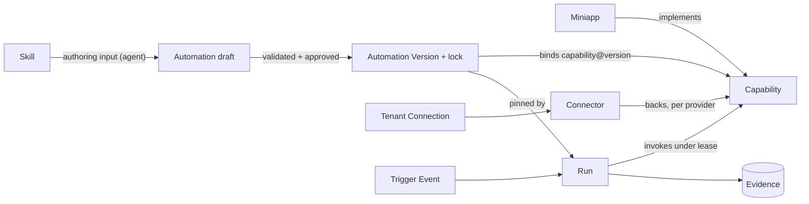

# Adversarial Review — Miniapp Studio Vision and Plan

**Artifact:** `plans/rpa-platform-grand-vision-review.md`
**Subject:** the vision, roadmap, and Prompt 37 as recorded in `roadmap7.md`
**Companion:** `plans/rpa-platform-grand-vision.md` (my plan; incorporates the amendments below)
**Verdict:** **APPROVED WITH AMENDMENTS**

---

## 0. Scope, method, limits

- **What I reviewed:** the full text of `roadmap7.md`: the status summary, the A/B roadmaps, the guardrails, the first grand-vision answer, the "platform primitives" correction, the webhook addition, and Prompt 37.
- **What I could not review:** the repository. I could not open `pithomlabs/miniapp` or `miniapp-studio`, the two plan documents the file links to, or any Go source. Every "Done", "exists", or "verified" status below is **as reported in `roadmap7.md` and unverified by me**. Prompt 37 already demands a source read; that requirement stands.
- **Vision preserved:** I do not challenge any of these, and I treat them as fixed:
  - A process-agnostic platform with few generic abstractions.
  - Business operations as capabilities, not primitives.
  - Skill → Automation → Miniapp → Capability → Connector.
  - Webhooks as a first-class abstraction.
  - A/B/C/D execution classes with ADR-001 gating Class D.
  - Neon only; Sprites for untrusted code, Machines for trusted.
  - Human approval for consequential effects.
  - API-first, no UI-RPA.
  - Two Studio experiences on one backend.
- **Severity:** Critical (breaks a locked invariant), High (likely incident or rework), Medium (real gap, bounded), Low (preference or implementation risk).
- **Blocker** means the item must be resolved before the named freeze or milestone. **Future risk** means it can be tracked.
- Each finding stays inside the vision and corrects it. None replaces it.

---

## 1. Summary

The vision is coherent and I would not change it. The weaknesses are in the plan and in several unstated contracts the vision depends on.

| # | Finding | Severity | Blocker for |
|---|---|---|---|
| RV-01 | Plan contradicts itself: "prove one automation first" vs. R0–R3 before W1 | High | Plan adoption |
| RV-02 | Process-agnosticism is asserted, and the only proof is one slice | High | Contract freeze |
| RV-03 | Durable waits are unavoidable in W1, and the design defers the question | High | R3 / ADR-001 timing |
| RV-04 | Provider-neutral capabilities smuggle in a canonical business ontology | High | R2 freeze |
| RV-05 | Owner approves an agent-authored explanation of the agent's own definition | High | Activation lifecycle |
| RV-06 | Untrusted inbound content steers agent outputs that feed effects | High | W1 intake |
| RV-07 | Event echo and runaway loops are unaddressed | High | Any trigger freeze |
| RV-08 | Approval-to-effect gap; unreconcilable capabilities; compound effects | Medium-High | Live money only |
| RV-09 | Sandbox/live and environment binding not stated as an invariant | Medium-High | Live money only |
| RV-10 | Webhook contract has security and correctness gaps | Medium-High | Webhook contract freeze |
| RV-11 | Polling was orphaned when "intake poll" was rejected as a primitive | Medium | Trigger freeze |
| RV-12 | Version pinning, deprecation, and attestation freshness unspecified | Medium-High | R2 freeze |
| RV-13 | Admission tests and attestations may be authored by the agent being checked | Medium | B-track admission |
| RV-14 | "Non-self-approval" is ambiguous for one-owner tenants; approval channels | Medium | Gate contract |
| RV-15 | Tenancy hierarchy arrives after the contract that depends on it | Medium | R0 |
| RV-16 | Evidence vs. privacy, erasure, payment-data scope, metering | Medium | W1 live; R7 |
| RV-17 | No kill-switch or blast-radius guarantees | Medium | R3 |
| RV-18 | Three overlapping taxonomies; "smallest set" is unanswerable | Medium | Spec acceptance |
| RV-19 | A/B tracks share an undeclared coupling point | Low | Future risk |
| RV-20 | Neon carries queue, dedupe, ledger, and ingress buffer | Low | Future risk |
| RV-21 | Unverified status claims and list gaps | Low | Spec adoption |

---

## 2. Findings

### RV-01 — The plan contradicts its own focus statement
- **Severity / blocker:** High; blocks plan adoption.
- **Where:** "Where I would focus" says finish Increment 3 and concentrate on W1. Section 6 of the grand-vision answer orders F0 → R0 → R1–R2 → R3 → W1 → R4–R8.
- **Scenario:** Following Section 6 literally, the team builds the contract, tenancy, catalog, and runtime before any business outcome exercises them. This is the "giant automation platform before proving one useful automation" that the document warns against. Separately, the Mom-n-Pop sequence (receipts, contacts, intake, scheduling, capabilities) is the P-series the owner rejected as primitives.
- **Why existing controls don't help:** nothing in the roadmap states that R-phases are bounded by what W1 needs.
- **Correction:** thin-slice rule: each of R0–R3 is delivered at the minimum W1 needs, with only the hard-to-reverse decisions frozen up front (see companion §14). The Mom-n-Pop items become capabilities and Miniapps, and the platform supplies only the mechanisms underneath.

### RV-02 — Process-agnosticism is untested by a single slice
- **Severity / blocker:** High; blocks the "v1 contract frozen" milestone.
- **Where:** Prompt 37 §11 puts the test as "new workflows without runtime changes", but the plan runs only Lead-to-Payment.
- **Scenario:** W1 shapes the core around CRM, invoicing, and payments (the first-slice distortion in Prompt 37 failure mode 19). Paper walkthroughs of onboarding or reporting pass because nobody can falsify them.
- **Correction:** require a second, structurally different process (**W-X**), run for real before the contract is declared v1. It should differ in trigger type, wait pattern, and effect profile. The companion suggests a read-heavy reporting process plus one fan-out case.

### RV-03 — Durable waits are unavoidable in W1, and the design defers them
- **Severity / blocker:** High; decides when ADR-001 evidence must exist.
- **Where:** "A workflow is not automatically Class D", plus ADR-001 deferral, versus W1 steps 4–7: owner approval, customer acceptance, payment, post-job review request.
- **Scenario:** W1 needs waits across hours or days and restarts. Prompt 37's own acceptance test is "approval survives suspension and restart". Without a stated wait model, each team invents one: cron polling, a status column, an ad hoc retry loop. That is the second orchestration engine the doc forbids.
- **Why existing controls don't help:** ADR-001 decides a substrate. It does not say what a wait is.
- **Correction:** fix the **semantics** in the spec: a wait is a persisted subscription with a correlation key, a timeout, and a resume trigger. Leave the **substrate** to ADR-001. Obtain ADR-001 evidence using W1's waits **before** the R3 freeze.
- **Related:** the Flow set (branch, bounded loop, parallel, wait, timeout, compensation) is a workflow language by any other name. Ship v1 with sequence, typed conditional, wait-with-timeout, and terminal outcomes. Defer loops, parallelism, and engine-level compensation until a use case forces them. Compensation is a capability.

### RV-04 — Provider-neutral capabilities reintroduce a business ontology
- **Severity / blocker:** High; blocks R2 freeze.
- **Where:** "How we avoid provider lock-in" (`party.contact.upsert` across HubSpot, Salesforce, GoHighLevel); the five-domain table (Party, Commercial, Engagement, Workforce, Ledger).
- **Scenario:** swappable providers require someone to own canonical contracts for each operation. At thousands of capabilities, that team becomes the catalog owner the owner explicitly rejected. Without an owner, each connector drifts and either the Automation breaks or a lowest-common-denominator contract forms.
- **Correction:** the platform owns the **grammar** of capability contracts and the rules to **compare** them (compatibility, conformance, declared deviations). It ships **no** canonical business schemas. Contract families are authored in the ecosystem, versioned, and optional. Processes bind to a family and version range, and connectors declare conformance plus deviations. The five-domain table is illustrative only and must not appear as a platform structure.

### RV-05 — Activation approval is over an agent-authored narrative
- **Severity / blocker:** High; blocks the activation lifecycle.
- **Where:** authoring lifecycle step 6 ("agent produces a human-readable process explanation") then step 7 ("owner reviews and authorizes activation").
- **Scenario:** the agent describes the definition. A subtle mismatch (a broader recipient set, a skipped gate, an extra effect) is not visible to a non-technical owner. This is a confused-deputy gap on the single most consequential approval.
- **Why existing controls don't help:** the material-hash binding covers per-action approvals such as an estimate. It does not obviously cover definition activation.
- **Correction:** the owner approves a **platform-rendered, deterministic definition diff**: capabilities and versions, effect inventory, gate inventory, triggers, destination scopes, and a list of unsupported requirements. The agent's prose is optional context and never the approval basis. Activation approval binds to the hash of the version.

### RV-06 — Untrusted content steers agent outputs that feed effects
- **Severity / blocker:** High; blocks W1 intake.
- **Where:** W1 step 2 (agent qualifies an inbound inquiry) feeding contact upsert, estimate, message send, review request. The agent-step contract (typed output, no credentials) is correct but incomplete.
- **Scenario:** a customer email contains instructions. The agent's structured output sets a recipient address, discount, or URL. Gates cover the estimate and the money, but low-gated steps (contact upsert, an automated review request "under policy") can still carry attacker-chosen values.
- **Correction:** provenance labels on values: any value derived from external content is **tainted**. Effect parameters that are tainted (recipient, amount, destination, template choice) require a gate or a closed-set validation. Prefer enumerations for agent outputs that drive effects. Record provenance in evidence.

### RV-07 — Event echo and runaway automations
- **Severity / blocker:** High; blocks any trigger-contract freeze.
- **Where:** nothing in the vision addresses causality between a process's own effects and its triggers. Cron has overlap prevention. Other trigger kinds have no stated equivalent.
- **Scenario:** a message send causes a provider webhook, which triggers the same Automation, which sends again. A CRM write emits an update event that re-enters contact upsert. Money and messages are the effects.
- **Correction:** propagate causality (origin run and effect IDs) onto trigger events. Events caused by an Automation's own effects are labeled, and policy suppresses or counts them. Add per-Automation and per-tenant run budgets, a depth limit, and a circuit breaker that suspends and alerts. Treat these as safety controls and implement them before billing.

### RV-08 — Approval-to-effect gap, unreconcilable effects, compound effects
- **Severity / blocker:** Medium-High; blocks **live** financial operations only.
- **Where:** "Approval is bound to its material fingerprint"; "never blindly repeat an UNKNOWN effect".
- **Scenarios:**
  1. Approved estimate or invoice drifts (price list, line items, provider state) between approval and send.
  2. A provider lacks idempotency keys and authoritative reads, so UNKNOWN can never be resolved automatically.
  3. "Issue invoice and deliver it" is treated as one effect, and a partial failure is ambiguous.
- **Correction:** (1) revalidate the material hash at effect time and refuse on mismatch. (2) The connector contract declares idempotency and reconciliation support. Without either, the capability is **non-reconcilable**: it cannot be auto-retried, and UNKNOWN routes to a human. (3) Each externally visible write is its own effect. Compounds are sequences.

### RV-09 — Sandbox vs. live and environment binding
- **Severity / blocker:** Medium-High; blocks live money.
- **Where:** "real tenant and controlled provider sandboxes before enabling live financial operations", plus environment separation listed in Prompt 37 §9.
- **Scenario:** a staging run leases live credentials, or a staging webhook endpoint is registered with a live provider account. Real money moves during a test.
- **Correction:** make it an invariant: every **connection** carries a mode (sandbox or live). Every run carries an environment. The broker refuses a lease when the pair is not permitted. Webhook endpoints are per environment and per connection.

### RV-10 — Webhook contract gaps
- **Severity / blocker:** Medium-High; amend before the webhook contract freezes.
- **Where:** Prompt 37 §4.D.
- **Gaps, each with a failure scenario:**
  1. **Persist before acknowledge.** Acknowledging before durable storage loses events on a crash.
  2. **Raw body verification.** Signature checks need the exact received bytes, and middleware that re-serializes breaks them or forces unsafe workarounds.
  3. **Dedupe identity.** Not all providers send a delivery ID. A payload-hash fallback wrongly drops legitimately repeated identical events.
  4. **Tenant binding under platform-level webhooks.** Some providers send all tenants' events to one registered endpoint with an account identifier in the payload. "Never trust payload claims" is correct, but those providers cannot be supported without a binding table created at connection enrollment. The rule becomes: a payload claim is usable only **after** signature verification and only through a pre-registered mapping.
  5. **Thin-event stance.** Out-of-order and duplicate deliveries are safest if the event is a **notification**, and the Automation reads authoritative state through a capability before acting.
  6. **Secret rotation.** It needs an overlap window accepting old and new secrets.
  7. **Pre-auth surface.** Size limits before parsing, uniform responses for unknown endpoints, per-endpoint rate limits, and cheap verification before any heavy work.
  8. **SSRF mis-scoped.** SSRF is an **egress** problem (connectors fetching URLs found in payloads), not an ingress one. Put an egress allowlist on connectors.
  9. **Quarantine visibility.** Poison deliveries need a dead-letter view in the Operations Studio.

### RV-11 — Polling was orphaned
- **Severity / blocker:** Medium; resolve at trigger freeze.
- **Where:** the owner rejected "P7 intake poll" as a business primitive. Triggers now list manual, API, internal events, schedule, and webhook, with no polling.
- **Scenario:** many small-business systems (mailboxes, legacy CRMs) offer no webhooks. Without a platform mechanism, every Miniapp reimplements cursor, watermark, dedupe, and overlap protection, and each does it slightly differently.
- **Correction:** the owner's objection is right about the business operation ("read this mailbox"), which is a capability. The reliability mechanism (cursor, dedupe, overlap lock) is generic and belongs to the Trigger family as a **poll source** that calls a connector-supplied "list since cursor" capability. This adds no business semantics to the core.

### RV-12 — Version pinning, deprecation, attestation freshness
- **Severity / blocker:** Medium-High; Prompt 37 lists it as a freeze item without answering it.
- **Scenario:** a Miniapp ships a breaking capability change while three Automations and nine runs reference the old one. Or a provider changes its API and an attestation from last month still reads "verified".
- **Correction:**
  - An Automation version resolves its capabilities to an immutable **lock** (capability, version, connector contract version) at activation.
  - A run pins that lock.
  - Breaking changes are new major versions, and an old major is retained until nothing active references it.
  - Promotion carries the lock across environments.
  - Attestations are signed, scoped to a connector version, and **expire**.
  - A failed re-attestation suspends affected Automations, which fail closed. Nothing is hot-swapped.

### RV-13 — The checked party may write the check
- **Severity / blocker:** Medium; blocks B-track admission rules.
- **Where:** "Safety checklists → Admission tests and policies"; agent-built Miniapps (B2) running on trusted Machines after promotion.
- **Scenario:** an agent writes a Miniapp and its tests. The tests pass because the agent wrote them to pass, and the Miniapp is admitted with an effectful capability nobody reviewed.
- **Correction:** admission uses platform-owned contract and conformance tests. Any **new effectful capability**, or a widened scope on an existing one, requires a human review of the capability diff. Attestation is issued by the platform, not by the author.

### RV-14 — Approver semantics and approval channels
- **Severity / blocker:** Medium; fix in the Gate contract.
- **Where:** "Approval separation and non-self-approval"; "separation between the proposing agent and approving authority".
- **Scenarios:** in a one-person business, a literal "initiator may not approve" rule means the owner cannot operate. Separately, owners will want to approve by text or email link, which creates a new authentication surface (bearer-link theft, replay, phishing).
- **Correction:** the base rule is **agent ≠ approver**. "Four-eyes" (initiator ≠ approver) is an optional tenant policy. Out-of-band approval channels use signed, single-use, hash-bound, expiring tokens, and are modeled as connectors.

### RV-15 — Tenancy hierarchy arrives after the contract that depends on it
- **Severity / blocker:** Medium; resolve in R0.
- **Where:** R0 (contract) precedes R1 (hierarchical tenancy).
- **Scenario:** the contract freezes on flat tenants. Agencies managing client tenants then force changes to RLS, credential ownership, webhook routing, and delegation.
- **Correction:** decide the **semantics** in R0 (scoping key on every row, whether delegation inherits, who owns connections), and implement flat first. Treat environment as a separate dimension from tenant.

### RV-16 — Evidence, privacy, payment-data scope, metering
- **Severity / blocker:** Medium; resolve before W1 goes live and before R7.
- **Scenarios:**
  1. Append-only receipts contain customer PII, and an erasure or retention request cannot be honored.
  2. Payment collection pulls card data into logs or receipts.
  3. "Tamper-proof audit" is claimed without a defined mechanism.
  4. Billing in R7 needs usage reconstructed from evidence that never recorded it.
- **Correction:** state that the platform never handles raw card data (provider-hosted tokens only). Receipts carry references and redacted payloads, with a retention class and an erasure path that tombstones PII while preserving the hash chain. Emit usage events from evidence from day one. Messaging consent and opt-out are capability-level duties, but the Gate must be able to consult them.

### RV-17 — No kill-switch or blast-radius guarantee
- **Severity / blocker:** Medium; resolve in R3.
- **Where:** lifecycle includes "suspended", but there are no guarantees about speed or scope.
- **Scenario:** a leaked credential or looping Automation. Operators cannot stop work at tenant, Automation, connection, capability, or endpoint level, and in-flight leases remain valid.
- **Correction:** specify stop controls at each level. A stop takes effect for new dispatches immediately, revokes outstanding leases, and parks in-flight runs at their next safe boundary.

### RV-18 — Three overlapping taxonomies
- **Severity / blocker:** Medium; blocks spec acceptance (Prompt 37 criterion 6).
- **Where:** the document presents "four concepts" (Automation, Miniapp, Capability, Connector), then "four central concepts" (Skills, Automations, Miniapps, runtime), then seven abstractions plus webhooks, then five layers.
- **Scenario:** two teams answer "what is the smallest set?" differently and build incompatible interpretations.
- **Correction:** one model with three roles: **nouns** (Skill, Automation, Miniapp, Capability, Connector), **mechanisms** (Process, Step, Flow, Trigger, Ingress, Gate, Effect, Evidence), and **foundation** (F0 services). Webhooks stay first-class as the Ingress contract feeding Trigger.

### RV-19 — A/B tracks share an undeclared coupling point
- **Severity / blocker:** Low; future risk.
- **Detail:** B-track builds produce capability descriptors and attestations that R2 consumes. "Must not block each other" holds only if a minimal capability-descriptor interface is declared early and kept stable.

### RV-20 — Neon carries many roles
- **Severity / blocker:** Low; future risk. The Neon-only decision is locked, and I do not challenge it.
- **Detail:** queue, dedupe store, evidence ledger, scheduler state, and ingress buffer all land on one database. Verify connection limits, burst behavior on webhook storms, and any scale-to-zero wake latency against provider delivery timeouts before relying on it for ingress.

### RV-21 — Unverified claims and list gaps
- **Severity / blocker:** Low.
- **Detail:** statuses such as "Done — Neon verified" and "approvals, effects, intent-hash already exist" are unverified here. The primitive list skipped P5, P10, and P12, so confirm nothing was dropped silently. The file also contains inline third-party image links and tracking parameters that should be removed before it becomes a governing document.

---

## 3. Checked and found sound

I tried to break these and did not find a structural defect, so I did not invent findings:

- A Skill is knowledge and not executable authority, and it grants no credentials.
- Business operations are capabilities, not primitives. The anti-bloat test questions in Prompt 37 §5 are enforceable.
- Agents hold no ambient credentials, and the broker issues short-lived, purpose-bound leases.
- Trust mode, execution category, and compute placement are independent dimensions.
- Classification at the tool or invocation boundary, rather than per Automation, is the right granularity.
- Inbound and outbound webhooks are treated separately, with outbound deferred.
- Receipts as evidence and not as authoritative remote state.
- Studio A/B as two information architectures over one backend.

---

## 4. Coverage of Prompt 37's twenty failure modes

| # | Failure mode | Findings |
|---|---|---|
| 1 | Primitive explosion | RV-04 |
| 2 | Over-abstraction | RV-18 |
| 3 | Workflow-engine duplication | RV-03 |
| 4 | Skill confusion | RV-05 (the Skill boundary itself is sound) |
| 5 | Automation/Miniapp confusion | RV-12 |
| 6 | Capability leakage | RV-04, RV-13 |
| 7 | Webhook confusion | RV-10, RV-11, RV-18 |
| 8 | Webhook security | RV-10 |
| 9 | Inbound/outbound confusion | No finding |
| 10 | Agent authority | RV-05, RV-06, RV-13 |
| 11 | Process determinism | RV-06 |
| 12 | External effects | RV-08 |
| 13 | Long-lived execution | RV-03 |
| 14 | Provider portability | RV-04 |
| 15 | Multi-tenancy | RV-09, RV-10, RV-15 |
| 16 | Versioning | RV-12 |
| 17 | Studio duplication | RV-19 |
| 18 | Premature complexity | RV-03 (Flow set), RV-04 |
| 19 | First-slice distortion | RV-01, RV-02 |
| 20 | Implementation feasibility | RV-20, RV-21 |

Additional modes found beyond the list: event echo (RV-07), kill switch (RV-17), evidence privacy (RV-16), approver semantics (RV-14).

---

## 5. Disposition

| Finding | Where the companion plan handles it |
|---|---|
| RV-01 | §14 thin-slice sequencing |
| RV-02 | §13, §14 (W-X gate) |
| RV-03 | §7 wait semantics; §14 ADR-001 timing |
| RV-04 | §5 contract-family governance |
| RV-05 | §6 definition diff |
| RV-06 | §6 agent-step contract; §10 INV-7 |
| RV-07 | §7, §10 INV-10 |
| RV-08 | §7 effect rules |
| RV-09 | §10 INV-3 |
| RV-10 | §8 |
| RV-11 | §8 poll as trigger source |
| RV-12 | §7 version locks; §10 INV-9 |
| RV-13 | §6, §10 INV-5 |
| RV-14 | §10 approver model |
| RV-15 | §10, §14 |
| RV-16 | §7, §10 INV-8, §15 |
| RV-17 | §10 INV-11 |
| RV-18 | §3 |
| RV-19 | §11 |
| RV-20, RV-21 | §15 verification gaps |

**Conditions for upgrading the verdict to APPROVED:**
1. Close RV-01 through RV-07 in the specification.
2. Complete the source read that Prompt 37 requires and reclassify every status claim.
3. Run the eight scenario tests in the companion §16 against the contract before freeze.


# Miniapp Studio — RPA Platform Grand Vision (Architecture Specification)

**Artifact:** `plans/rpa-platform-grand-vision.md`
**Status:** Draft v0.1, design stage. No code, schemas, endpoints, or migrations are specified or implied.
**Companion:** `plans/rpa-platform-grand-vision-review.md` (finding IDs `RV-xx` below refer to it)
**Governing source:** `roadmap7.md` (the vision and Prompt 37). The vision is preserved. This plan sharpens its contracts and sequencing.

### Evidence legend and honesty note
`[I]` implemented · `[A]` accepted · `[D]` designed · `[P]` proposed here · `[X]` deferred · `[U]` unverified.

I could not read the repository or the two linked plan documents. Every `[I]` status below is **as reported in `roadmap7.md`** and must be reclassified by the source read in §15 before adoption. Nothing here claims a feature exists unless the roadmap says so, and even then it is `[U]`.

---

## 1. Executive vision

Miniapp Studio is a multi-tenant, API-first RPA platform. A business owner describes a process in plain language. An AI agent, using reusable **Skills** and the tenant's available **Capabilities**, proposes a declarative **Automation**. The platform validates it, the owner approves its activation, and the runtime executes it with authorization, idempotency, approvals, evidence, and recovery.

> Miniapp Studio should understand how to execute and govern a business process, not understand every business process that exists.

The platform is the machinery. Business meaning lives in Miniapps and connectors. The test of success is not how many workflows ship. It is whether a **new** workflow, a **new** capability, or a **new** provider can be introduced without changing the platform runtime.

---

## 2. Goals, non-goals, principles

**Goals**
- Process-agnostic core: few generic mechanisms, unlimited business capabilities.
- Capability-driven, API-first, agent-native, composable, provider-independent, multi-tenant.
- Reliable external effects: no duplicated money or messages after ambiguity.
- One backend serving Engineering Studio (Roadmap A) and Automation Operations Studio (Roadmap B).

**Non-goals**
- A CRM, ERP, accounting engine, or marketing platform inside Studio.
- A visual workflow canvas, plugin marketplace, or proprietary agent runtime.
- UI-RPA or screen scraping (deferred, per locked scope).
- A general-purpose workflow programming language.
- A second orchestration engine outside the A/B/C/D classes and ADR-001.

**Governing principles**

| ID | Principle |
|---|---|
| GP-1 | Compose before abstracting. A new platform mechanism must pass the five anti-bloat questions (§5). |
| GP-2 | Knowledge ≠ code ≠ definition ≠ authority. Skills, Miniapps, Automations, and permissions are separate things. |
| GP-3 | Agents propose. The platform validates. Humans authorize. The runtime executes. |
| GP-4 | Fail closed: tenant context, capability availability, attestation, environment binding. |
| GP-5 | Receipts are evidence, not the authoritative state of remote objects. |
| GP-6 | An unknown outcome is never retried blindly. |
| GP-7 | Reuse the existing Miniapp contracts, approvals, effects, and broker. Extend only with justification. |
| GP-8 | Semantics are frozen early. Substrates and schemas are decided late. |

---

## 3. Vocabulary and conceptual model

One model, three roles `[P]` (resolves RV-18):

| Role | Terms |
|---|---|
| **Nouns** (what things are) | Skill · Automation · Miniapp · Capability · Connector (plus Connection) |
| **Mechanisms** (how the platform behaves) | Process · Step · Flow · Trigger · Ingress · Gate · Effect · Evidence |
| **Foundation** (F0 services) | Identity · Tenancy/RLS · Authorization · Secrets · Credential broker · Persistence · Observability |

### 3.1 Nouns

- **Skill.** Reusable business knowledge for agents: objectives, decision rules, sequencing guidance, required capability references, safety checklists, examples. It is not executable, grants no credentials, and confers no permission. Skills are consumed through the agent layer in existing declarative-skill formats. No proprietary skill runtime is built.
- **Automation.** The business-facing declarative definition of a process: objective, triggers, steps, input/output mappings, flow, gates, policies, error and recovery behavior, tenant and environment association. It composes capabilities. It contains no provider-specific code.
- **Miniapp.** A versioned executable implemented within the Miniapp framework. It exposes one or more capabilities through declared contracts and tested handlers. It holds domain logic and does not know the process that calls it. Automation↔Miniapp is many-to-many.
- **Capability.** A typed, versioned, invokable operation: identity and version, input/output contracts, invocation semantics, authorization and trust requirements, idempotency and retry declarations, execution category, provenance, attestation status. The platform keeps no hardcoded list of business capabilities.
- **Connector.** The replaceable boundary to an external provider. It owns provider auth, transport, pagination, rate limits, webhooks, errors, and honest declaration of unsupported or restricted capabilities.
- **Connection.** A tenant's binding to a provider: credentials (via the broker), mode (**sandbox** or **live**), environment, and observed availability.

### 3.2 Definition objects vs. runtime objects

| Object | Kind | Notes |
|---|---|---|
| Automation | Definition container | Holds drafts and the lineage of versions. |
| Automation Version | Definition, **immutable** | Content-hashed. Carries a **lock** resolving each capability to an exact version and connector contract version (RV-12). |
| Trigger Event | Runtime input | Normalized, tenant-bound, deduplicated (§8). |
| Run | Runtime state | Pins one Automation Version and its lock for its whole life. |
| Step execution | Runtime state | One attempt of one step within a Run. |
| Capability invocation | Runtime state | A call to a capability under a lease. |
| Effect | Runtime state | One externally visible write, with its own lifecycle (§7.3). |
| Receipt | Evidence, append-only | Immutable record of decisions, outcomes, deliveries, effects. |

### 3.3 Relationship diagram (conceptual, not topology)



---

## 4. The minimal platform abstractions

Eight mechanisms in three roles `[P]`. Webhooks are first-class as **Ingress**, which feeds Trigger.

| Role | Mechanism | Purpose |
|---|---|---|
| **Describe** | **Process** | The declarative definition of what should happen (an Automation Version). |
| | **Step** | A typed invocation of a capability, with validated inputs, output mapping, and an effect on subsequent flow. |
| | **Flow** | Minimum control semantics: sequence, typed conditional, wait-for-event with timeout, terminal outcomes. |
| **Start** | **Trigger** | How a Run starts or resumes: manual, API, internal event, schedule, poll source, or an Ingress event. |
| | **Ingress** | Inbound webhook intake as a first-class contract, from endpoint to verified event to Trigger (§8). |
| **Govern** | **Gate** | Policy plus human authorization at the invocation boundary. |
| | **Effect** | Framework-owned handling of externally visible writes. |
| | **Evidence** | Append-only receipts for runs, steps, decisions, deliveries, invocations, and effects. |

**Flow v1 is deliberately small** `[P]` (RV-03):
- **In v1:** sequence, typed conditional on declared values, wait-for-event with timeout, terminal success/failure.
- **Deferred `[X]`:** bounded iteration, parallel branches, engine-level compensation. Compensation is a capability. Fan-out belongs inside a Class C capability (§13).
- Admission criterion for extending Flow: a concrete process that cannot be expressed by composition, shown in a failing architecture test.

**What is not a mechanism:** contact upsert, estimate creation, invoicing, payments, messaging, review requests, job sync, booking, payroll, inventory. These are capabilities.

---

## 5. Platform vs. business capability

### 5.1 Anti-bloat test
A proposed new core mechanism is accepted only if **all five** conditions hold:
1. It is genuinely generic across unrelated processes.
2. It **cannot** be represented with Process, Step, Flow, Trigger, Ingress, Gate, Effect, and Evidence.
3. It introduces **no** domain semantics into the core.
4. It solves a cross-process reliability or security problem.
5. Its absence can be shown as a concrete failing scenario.

If any condition fails, the need is met by composition, a Miniapp, or a connector.

### 5.2 Where things live

| Concern | Location |
|---|---|
| "Create a contact", "issue an invoice", "collect payment", "send a message" | Business Miniapp, optionally backed by a Connector |
| "Read this mailbox since a cursor" | Connector capability (business-specific read) |
| Cursor, dedupe, overlap lock for polling | Platform: Trigger **poll source** (RV-11) |
| Idempotency, retry, UNKNOWN handling | Platform: Effect |
| Approval binding and expiry | Platform: Gate |
| Estimate pricing math | Deterministic Go inside a Miniapp |
| Interpreting an ambiguous inquiry | Agent step (§6.3) |
| Credentials | F0 broker, never the agent or the Automation |

### 5.3 Contract-family governance `[P]` (RV-04, Owner Decision OD-1)
Provider swapping requires comparable contracts, and that cannot be hand-waved.

- The platform owns the **grammar** of capability contracts, the **comparison rules** (compatibility, conformance, declared deviations), and the **registry mechanics**.
- The platform ships **no canonical business schemas.** Reference families may exist as ordinary Miniapps.
- A **contract family** is authored and versioned by whoever defines it (a Miniapp author, a vendor, a tenant). An Automation binds to a family and a version range.
- A connector declares **conformance** to a family, plus **deviations** and unsupported operations. There is no forced lowest common denominator, and unsupported operations surface honestly.
- The earlier five-domain table (Party, Commercial, Engagement, Workforce, Ledger) is illustrative only and is **not** a platform structure.

---

## 6. Authoring lifecycle: Skill → Automation

### 6.1 Steps
1. The owner states a desired outcome.
2. The agent discovers applicable Skills and the tenant's available, attested capabilities.
3. The agent identifies operations, decisions, inputs, and triggers.
4. The agent produces an Automation **draft**. The agent can create drafts and nothing else.
5. The platform **validates** the draft (§6.2).
6. The platform renders a **definition diff** (§6.2). The agent's prose is optional context only (RV-05).
7. The owner reviews the diff and authorizes activation. Authorization binds to the version hash.
8. The runtime executes under the Automation Version's lock.
9. Studio shows run evidence, approvals, failures, and recovery.
10. Revisions create new drafts and versions. An active version cannot be silently modified. Promotion is explicit.

### 6.2 Validation outputs and the definition diff `[P]`
Validation returns a platform-generated, deterministic report, which is the basis of owner approval:
- Resolved lock (capability, version, connector contract version).
- **Effect inventory:** every externally visible write, destination scope, and reconciliation support.
- **Gate inventory:** what requires human approval and what is policy-gated.
- **Trigger inventory:** including webhook endpoints and poll sources.
- **Taint report:** which effect parameters derive from external content (§6.3).
- **Unsupported requirements:** things the process needs that no attested capability provides. The agent must list them, never fabricate support.

### 6.3 Agent-step contract `[P]` (RV-06)
An agent step is a Step with a constrained contract:
- **Declared inputs** only, passed by the runtime.
- **Structured output** validated against a schema. Outputs that drive effects use closed sets (enumerations) wherever possible.
- **No authority.** An agent step proposes. It performs no effect and holds no credentials. Effectful Steps execute under Gates.
- **Declared budget:** time and token limits.
- **Provenance labels:** values derived from external content (inbound email, webhook payloads, documents) are **tainted**. A tainted value used in an effect parameter (recipient, amount, destination, template) requires a gate or closed-set validation.
- Deterministic business rules (pricing, eligibility) live in Miniapp code, not in agent steps.

### 6.4 Mapping Skill content

| Skill content | Target |
|---|---|
| Instructions, examples | Agent-only guidance |
| Business rules | Deterministic domain logic in a Miniapp |
| Actions | Capability references |
| Sequencing, decisions | Flow in the Automation |
| "When to start" | Trigger configuration |
| "Ask the owner first" | Gates |
| Safety checklist | Admission tests and policy |
| Operational notes | Runbooks (Operations Studio) |
| "How do we know it works" | Test and verification requirements |

### 6.5 Automation lifecycle
`Draft → Validated → Approved for activation → Active ↔ Suspended → Retired`
- Testing and promotion across environments (development, preview, staging, production) promote the **lock**, not a rebuilt definition.
- A failed re-attestation, kill switch, or breaker moves an Automation to **Suspended**, failing closed.

---

## 7. Runtime and execution semantics

### 7.1 Execution classes
Classification applies at the **tool or invocation boundary** `[A]`, not to an Automation as a whole.
- **A:** synchronous request or transaction.
- **B:** independently retryable background work.
- **C:** bounded multi-step or batch work with progress and recovery.
- **D:** durable workflow with long-lived waits, checkpoints, and human or external events.

An Automation composes capabilities of different classes. It does not introduce a second orchestration model. Trust mode (dry-run, confirm, autonomous), execution class, and compute placement remain independent dimensions.

### 7.2 Waits and resumption `[P]` (RV-03)
Many processes cannot complete in one sitting (owner approval, customer acceptance, payment, post-job follow-up). The spec fixes the **semantics** and leaves the **substrate** to ADR-001:
- A **wait** is a persisted subscription with a **correlation key**, a **timeout**, and a **resume trigger**.
- A parked Run holds no compute. Resume arrives as a Trigger Event matched by correlation key.
- Timeout produces a declared branch, and the Run never hangs silently.
- Waits survive restarts, deploys, and suspension. An approval wait survives all three.
- ADR-001 decides how this is implemented. It must be evidenced **using W1's wait pattern before R3 freezes** (§14).

### 7.3 Effects `[P]` (RV-08)
Lifecycle: **intent registered → attempt → confirmed | failed-terminal | UNKNOWN**, then **reconciliation**.
- Each externally visible write is its own Effect. "Issue invoice and deliver it" is two.
- **Idempotency identity** is derived from Run, step, and intent, and passed to providers that support provider-side idempotency.
- **UNKNOWN is never retried blindly.** Resolution is by authoritative read, where the connector supports it.
- **Non-reconcilable capabilities:** a connector must declare idempotency and reconciliation support. A capability with neither cannot be auto-retried. Its UNKNOWN routes to a human.
- **Effect-time revalidation:** a gated Effect re-checks the approved material hash at execution. On mismatch it refuses and re-requests approval.
- **Causality:** every Effect carries origin Run and Effect IDs. Provider events caused by it can be recognized (§7.5).

### 7.4 Recovery
- Step dispatch is at-least-once, with claims, leases, and heartbeats. Effects are made safe by idempotency, not by hoping for exactly-once dispatch.
- After a crash, a Run resumes from its last durable boundary.
- Failure classes are distinct: **business** (invalid data, do not retry), **transient** (backoff), **unknown** (reconcile), **policy** (gate or suspend).

### 7.5 Loop and amplification protection `[P]` (RV-07)
- Events carry a **causality chain**. Events caused by an Automation's own Effects are labeled, and policy suppresses or counts them.
- Per-Automation and per-tenant **run budgets**, a **depth limit**, and a **circuit breaker** that suspends and alerts.
- These are safety controls, delivered before metering and billing (R7).

### 7.6 Versioning `[P]` (RV-12)
- A Run pins its Automation Version and lock. It completes on that lock.
- A breaking capability change is a new major version. The old major is retained until no active Automation or in-flight Run references it.
- Forced migration of a running Run requires an explicit owner action and a compatibility check.
- Attestations are signed, tied to a connector version, and **expire**. Expiry or failure suspends dependents.

### 7.7 Webhook acknowledgement and execution
Providers must not wait for an Automation. Ingress **persists the verified delivery durably, then acknowledges**, then dispatches asynchronously (§8).

---

## 8. Event sources, Ingress, and webhooks

### 8.1 Different sources, one normalized envelope

| Source | Trust basis | Identity / dedupe | Owner of cursor or state |
|---|---|---|---|
| Manual | Authenticated human | Request key | n/a |
| API | Authenticated principal | Idempotency key | n/a |
| Internal event | Platform | Event ID | Platform |
| Schedule | Platform | Schedule slot ID, with overlap prevention | Platform |
| **Poll source** | Connection credentials | Item identity + cursor | Platform owns cursor and overlap lock. A connector capability supplies "list since cursor". |
| **Inbound webhook (Ingress)** | Signature verification + registered endpoint | Provider delivery ID, else a documented fallback | Platform |

All sources produce one **Trigger Event** envelope `[P]` (conceptual): source, tenant, environment, dedupe identity, causality chain, received time, payload reference. There is **one** dedupe-and-dispatch path, so there are no four idempotency mechanisms.

### 8.2 The webhook chain: six distinct concepts

```
Endpoint (registered, tenant+env+connection)
  → Delivery (one HTTP request)
    → Verification (signature, timestamp, size)
      → Event (normalized, validated)
        → Routing (tenant, subscription, Automation)
          → Trigger invocation (start or resume a Run)
```
A webhook is not an internal event, and not an Automation.

### 8.3 Contracts

- **Endpoint registration and lifecycle:** created for a tenant, environment, and connection. States: active, rotating, disabled. Disabled endpoints return the same response as unknown ones.
- **Verification:** provider-specific signature check against the **raw received bytes**, plus timestamp tolerance. Verification happens before any expensive work. Size limit applies before parsing.
- **Secrets:** stored through the F0 secrets layer. **Rotation** has an overlap window accepting old and new secrets.
- **Tenant binding:**
  1. *Endpoint-scoped* (default): tenant derives from the registered endpoint.
  2. *Claim-mapped* (for providers that send many tenants' events to one endpoint): a payload account identifier is usable **only after** signature verification and **only** through a mapping created at connection enrollment.
  3. Never from an unverified payload claim.
- **Persist then acknowledge:** the delivery is durably stored, then acknowledged. Processing is asynchronous.
- **Duplicates and replay:** dedupe on provider delivery ID, else a documented fallback that does not drop legitimately repeated identical events. A replay window plus a seen-set rejects replays.
- **Out-of-order and thin events:** the default stance is that an event is a **notification**. The process reads authoritative state through a capability before acting on it.
- **Failure and quarantine:** malformed, unverifiable, or poison deliveries go to a quarantine surface visible in the Operations Studio. Nothing is dropped silently.
- **Rate and abuse limits:** per-endpoint rate limits and uniform responses for unknown endpoints.
- **Environment isolation:** endpoints are per environment and per connection (INV-3).
- **SSRF:** it is an **egress** concern. Connectors follow an egress allowlist for any URL found in payloads.
- **Relationship to ledger:** each delivery produces a receipt, and a correlated Trigger Event produces a link from receipt to Run.

### 8.4 Outbound webhooks `[X]`
Outbound delivery is modeled as a **capability plus Effect** and reuses connector contracts. No new delivery machinery is added initially. Revisit only if a concrete need for managed subscriber endpoints, signing, and retry schedules cannot be met by composition (OD-7).

---

## 9. API-first architecture

Principle: one domain service layer. Studio interfaces and agents are clients of the same contracts. There is no separate business logic per consumer. Endpoint paths and JSON schemas are intentionally not defined here and need later ADRs and implementation specs.

| API surface | Consumer | Responsibility | Tenant authorization |
|---|---|---|---|
| Automation management | Operators, agents, Engineering Studio | Drafts, versions, lineage | Tenant-scoped, RLS |
| Validation and activation | Agents (validate), humans (activate) | Validation report, definition diff, activation approval | Activation requires a human authority principal |
| Execution / invocation | Operators, systems | Manual and API triggers | Principal-scoped, idempotency key |
| Run status and evidence | Operators, QA | Run history, receipts, UNKNOWN effects | Tenant-scoped reads |
| Approval / decision | Human approvers | Present exact material, record decision | Approver ≠ agent |
| Capability discovery | Agents, authors | Attested capabilities, deviations, availability | Informational only, never grants execution |
| Connection management | Tenant admins | Connect, mode, rotate, revoke | Admin role, broker-mediated |
| Webhook registration and ingress | Admins (registration), providers (ingress) | Endpoint lifecycle; pre-auth intake | Registration tenant-scoped; ingress via verification |
| Event and trigger dispatch | Platform internal | Normalized Trigger Event routing | Internal, tenant-bound |

---

## 10. Identity, tenancy, security, governance

### 10.1 Invariants (the fixed security contract)

| ID | Invariant |
|---|---|
| INV-1 | Tenant context derives only from an authenticated principal or a **trusted registration**. Fail-closed RLS. |
| INV-2 | No ambient credentials. Execution receives short-lived, purpose-bound broker leases. Deployment secrets stay separate from tenant credentials. |
| INV-3 | Every Connection has a mode (sandbox or live). Every Run has an environment. The broker **refuses** a lease for a disallowed pair. Webhook endpoints are per environment and connection. (RV-09) |
| INV-4 | An agent never approves. Approvals bind to a material hash and expiry, and are **revalidated at effect time**. |
| INV-5 | Only registered, version-pinned, **attested** capabilities are invocable. Admission uses platform-owned conformance tests, and new or widened effectful capabilities need human diff review. (RV-13) |
| INV-6 | Effects are idempotent. UNKNOWN is never auto-retried unless the capability is reconcilable. |
| INV-7 | Values derived from untrusted content are tainted. Tainted effect parameters require a gate or closed-set validation. |
| INV-8 | Evidence is append-only, redacted, retention-classed, and has an erasure path that tombstones PII while preserving integrity. The platform never handles raw card data. |
| INV-9 | A Run pins its lock. Attestations expire. Failure suspends dependents (fail closed, no hot-swap). |
| INV-10 | Causality tracking and run budgets with a circuit breaker apply to every trigger source. |
| INV-11 | Stop controls exist at tenant, Automation, Connection, capability, and endpoint level. A stop blocks new dispatch immediately, revokes outstanding leases, and parks in-flight Runs at the next safe boundary. (RV-17) |

### 10.2 Tenancy and delegation
- Organization → tenant → workspace. Delegation is explicit and revocable.
- Automation definitions, versions, runs, connections, and endpoints are tenant-scoped.
- Scoping key on every row decided in R0, with hierarchy **semantics** (inheritance, delegation, connection ownership) decided early and implemented flat first `[P]` (RV-15).
- Environment is a dimension separate from tenant.

### 10.3 Approvers `[P]` (RV-14)
- Base rule: **agent ≠ approver.** Humans may approve their own initiated actions, so a one-person business can operate.
- Optional tenant policy: four-eyes (initiator ≠ approver).
- Out-of-band approval channels (text or email links) use signed, single-use, hash-bound, expiring tokens, and are modeled as connectors.

---

## 11. Studio: the two experiences

Both are clients of the same backend (§9), with distinct information architecture.

| | **Engineering Studio (Roadmap A, B0–B5)** | **Automation Operations Studio (Roadmap B, R0–R8)** |
|---|---|---|
| Audience | Developers and coding agents | Owners, operators, QA, managers |
| Does | Author Miniapps, define and validate contracts, test, preview, release, diagnose | Discover Skills and capabilities, configure Automations and triggers (including webhooks), manage connections, approve, monitor runs, resolve UNKNOWN effects, inspect evidence |
| Shares | Domain services, identity, authorization, connectors, runtime, evidence | Same |

**Coupling point (RV-19):** B-track builds emit capability descriptors and attestations that R2 consumes. A minimal, stable capability-descriptor interface is declared early so the tracks progress independently.

---

## 12. Lead-to-Payment as an architectural proof

An example Automation, not a catalog of platform operations. Every capability named below is business-owned.

| Stage | Mechanism | Business capability | Gate | Effect | Evidence / wait |
|---|---|---|---|---|---|
| 1. Inquiry received | **Ingress** (webhook) or **poll source** | none | none | none | Delivery receipt; Trigger Event |
| 2. Qualify and identify | Agent step (read-only) then typed conditional | Contact lookup; contact upsert | Policy | Upsert is an idempotent Effect | Decision receipt with provenance (tainted) |
| 3. Prepare estimate | Step | Deterministic pricing in a Miniapp | none | Draft record | Input/output hash |
| 4. Owner approval | **Gate** + **Wait** | none | Human approval bound to estimate hash and expiry | none | Decision receipt; durable wait |
| 5. Send estimate | Step | Message send via connector | Satisfied above; recipient taint check | Effect | Receipt |
| 6. Customer acceptance | **Wait** resumed by Ingress/poll event, correlation key = estimate | none | none | none | Correlated event receipt; timeout branch |
| 7. Schedule job | Step | **Calendar capability: not yet existing `[U]`** | Policy | Effect | Receipt |
| 8. Invoice | Step | Invoice issue, then delivery | Money gate bound to invoice hash, revalidated at effect time | Two Effects | Receipts |
| 9. Collect payment | Step + **Wait** on provider webhook (thin event) | Payment status read | Per capability | Provider-hosted payment link, so no raw card data | Authoritative read; receipt |
| 10. Request review | Timer **Wait** then Step | Message send | Policy gate (consent and opt-out check) | Effect | Receipt |
| 11. Report | Terminal | none | none | none | Final receipts and run summary |

**What the platform does not know:** what an estimate, invoice, or review is, and which provider is used.

**Risks to track:** first-slice distortion (RV-02), egress allowlist, sandbox/live binding (INV-3) before any live charge.

---

## 13. Generality: unrelated processes, same core

| Process | Triggers | Waits | Gates | Effects | Core change? |
|---|---|---|---|---|---|
| Employee onboarding | HR-system webhook or manual | Days (documents, equipment) | Manager approves access grants | Account creation, email | No |
| Order fulfillment | Order-created webhook | Shipment and delivery events | Money and refund gates | Reserve stock, buy label | No |
| Financial reporting | Schedule | None | None for reads; policy for distribution | Distribute report | No; mostly Evidence |
| Marketing campaign | Schedule or manual | Per-recipient responses (optional) | Content approval, consent check | Bulk send | **Edge case** (below) |

**Honest edge:** a campaign fans out to N recipients. The v1 answer is a **Class C capability** that does the batch with progress and recovery. If a process needs per-recipient gates or waits, Flow would need bounded iteration. That is a legitimate, evidenced reason to extend Flow, and it is recorded as a future core change under the §4 admission criterion, not silently absorbed.

**W-X** (§14): the second real process, chosen to differ from W1 in trigger type, wait pattern, and effect profile.

---

## 14. Dependency-ordered roadmap

Existing numbering preserved: F0, Roadmap A (B0–B5), Roadmap B (R0–R8), runtime track and ADR-001 gates. Nothing here modifies the Ultimate Roadmap. The **thin-slice rule** applies: R0–R3 are delivered at the minimum W1 needs, so W1 drives them (RV-01).

### 14.1 Stages

| Stage | Work | Exit criteria |
|---|---|---|
| **0. F0 close-out** | Finish Increment 3 (invitations, capability refresh); remaining F0 gaps; **source verification pass** (§15) | Every `[U]` reclassified |
| **1. R0-min** | Freeze the hard-to-reverse decisions (§14.2) as short design decisions | Review amendments RV-01..RV-07 closed |
| **2. ADR-001 evidence** | Evidence for the wait semantics (§7.2) using W1's wait pattern | ADR-001 decision recorded |
| **3. R1-min / R2-min / R3-min** | Flat tenancy with decided hierarchy semantics; capability descriptor, lock, attestation; trigger envelope, Ingress persistence, step dispatch, waits, gates, effects (reusing existing machinery) | W1 slice runnable end to end in sandbox |
| **4. W1 Lead-to-Payment** | Sandbox providers only. **Live money disabled.** | Scenario tests (§16) pass |
| **5. W-X and contract v1 freeze** | Second, structurally different real process | No runtime change needed, or the change is recorded under §4 |
| **6. Live-enable gate** | INV-3, effect-time revalidation, reconciliation, kill switch verified | Owner signs off |
| **7. R4–R6** | Operations workspace, environments and promotion, tenant onboarding | Per roadmap |
| **8. R7–R8** | Metering, quotas, billing, enterprise scale, governance (usage events already emitted from evidence) | Per roadmap |
| **W2, W3** | Missed-call-to-booked-job; campaign-to-cash | After stage 6 |

Roadmap A (B0–B5) continues in parallel and never waits on R-phases. They meet at the capability-descriptor interface (§11).

### 14.2 Decisions to freeze early (hard to reverse)

| ID | Decision |
|---|---|
| H1 | Tenant scoping key and hierarchy semantics |
| H2 | Automation Version, lock, and Run pinning |
| H3 | Trigger Event envelope, dedupe identity, causality tags |
| H4 | Wait and resume semantics; conceptual Run states |
| H5 | Effect lifecycle including UNKNOWN and reconcilability |
| H6 | Gate binding: hash, expiry, effect-time revalidation, approver rule |
| H7 | Agent-step boundary and taint labels |
| H8 | Environment and connection-mode binding |
| H9 | Capability descriptor and attestation minimum |
| H10 | Ingress contract: persist-then-ack, verification, tenant binding modes |

**Freeze later `[X]`:** Flow extensions (iteration, parallel, compensation), outbound webhook machinery, the authoring DSL's concrete syntax, Studio screen design, the metering schema, visual designer, marketplace.

### 14.3 What is what

| Category | Items |
|---|---|
| **Reported implemented `[I][U]`** | Unified secrets management; credential broker with encrypted storage and leases (Neon verified); approvals, effects, intent-hash mechanisms (reported to exist) |
| **In progress `[U]`** | Tenant invitations and capability refresh (Increment 3) |
| **Reuse** | MiniappSpec, manifest, CapabilityRef, execution classes, admission, approvals, effects, idempotency, RLS, broker |
| **New abstractions genuinely required** | Ingress contract (incl. persistence and tenant binding), Trigger Event envelope, Automation Version lock, wait/resume semantics, taint labels, causality tags, stop controls |
| **Deferred `[X]`** | Visual canvas, marketplace, UI-RPA, proprietary agent runtime, outbound webhook machinery, Flow loops/parallel/compensation |

---

## 15. Open decisions, deferred topics, verification gaps

### 15.1 Owner decisions

| ID | Decision | Why it needs the owner |
|---|---|---|
| OD-1 | Contract-family governance: who authors and approves families | Product and ecosystem scope |
| OD-2 | Approver model: base rule and optional four-eyes | Product fit, security |
| OD-3 | Payment posture: platform never touches raw card data | Irreversible compliance exposure |
| OD-4 | Messaging consent and opt-out: capability duty vs. platform policy hook | Legal exposure |
| OD-5 | Evidence retention classes and erasure path | Legal, irreversible |
| OD-6 | Hierarchy semantics (inheritance, delegation, connection ownership) | Hard to reverse |
| OD-7 | Outbound webhooks: stay as capability+effect or add machinery | Scope |
| OD-8 | Poll source as a Trigger variant (RV-11) | Confirms a refinement of the owner's primitive decision |
| OD-9 | Default run budgets and circuit-breaker thresholds | Safety vs. convenience |
| OD-10 | Whether the owner accepts the thin-slice resequencing (RV-01) and the W-X gate | Plan |

### 15.2 Verification gaps (must close before adoption)
Read the actual source and reclassify each as `[I]` or `[U]`:
1. Real paths and contents of `contract/manifest.go` and `contract/policy.go`.
2. Whether the existing approval and intent-hash machinery supports **effect-time revalidation** and expiry.
3. Whether broker leases can bind to environment and connection mode (INV-3).
4. Whether RLS is fail-closed at every table the new objects will touch.
5. Existing event intake, cron overlap prevention, and watermark handling.
6. The text of ADR-001 and the status of any Class D evidence.
7. Existing `CapabilityRef` shape and attestation or inventory mechanisms.
8. Increment 3 completion state and any open F0 gaps.
9. Neon operational limits relevant to ingress and queueing (RV-20).
10. Whether primitives P5, P10, P12 were dropped or never defined (RV-21).

### 15.3 Deferred topics `[X]`
Outbound webhook delivery machinery; UI-RPA; visual canvas; marketplace; multi-region; advanced analytics.

---

## 16. Architecture acceptance criteria

### 16.1 The twenty questions

| # | Question | Short answer | § |
|---|---|---|---|
| 1 | What is a Skill? | Reusable agent-facing knowledge with no authority | 3.1 |
| 2 | What is an Automation? | Declarative, versioned business-process definition | 3.1 |
| 3 | What is a Miniapp? | Versioned executable that exposes capabilities | 3.1 |
| 4 | What is a Capability? | Typed, versioned, invokable operation | 3.1 |
| 5 | What does a Connector own? | Provider auth, transport, quirks, honest limits | 3.1 |
| 6 | Smallest abstraction set? | Process, Step, Flow, Trigger, Ingress, Gate, Effect, Evidence | 4 |
| 7 | Where do webhooks enter? | Ingress, then Trigger | 8 |
| 8 | Webhooks vs. events, polling, schedules? | Different sources, one normalized envelope and dedupe path | 8.1 |
| 9 | Who decides what an agent can execute? | Attested capability + lock + gates + human authority | 6, 10 |
| 10 | Where do deterministic rules live? | Miniapp code | 5.2 |
| 11 | Where does agent reasoning live? | Constrained agent steps that only propose | 6.3 |
| 12 | Crash recovery? | Durable boundaries, claims and leases, idempotent effects | 7.4 |
| 13 | How are side effects made safe? | Effect lifecycle, UNKNOWN handling, revalidation | 7.3 |
| 14 | Long-running processes without a new engine? | Wait semantics now, ADR-001 substrate | 7.2 |
| 15 | New capability without platform code? | New Miniapp/contract family, same grammar | 5.3 |
| 16 | New Automation without runtime change? | Compose existing capabilities | 6, 13 |
| 17 | New provider without rewriting the Automation? | Connector conformance + deviations | 5.3 |
| 18 | Tenant and credential isolation? | INV-1, INV-2, INV-3 | 10 |
| 19 | How do the Studios relate? | Shared backend, separate IA | 11 |
| 20 | Why no bloat? | Anti-bloat test and Flow admission criterion | 4, 5 |

### 16.2 Scenario tests

| # | Scenario | Pass condition |
|---|---|---|
| T1 | New business process | Defined and run with no runtime change |
| T2 | New business capability | Added as a Miniapp with no new primitive |
| T3 | New provider | Added as a connector, Automation unchanged where conformance holds |
| T4 | New inbound webhook trigger | Registered without provider-specific logic in the Automation |
| T5 | Unsupported provider capability | Surfaced honestly in validation, never fabricated |
| T6 | Unregistered or unauthorized capability | Agent cannot cause its execution |
| T7 | Duplicate delivery + ambiguous effect | One run; no duplicate effect; UNKNOWN reconciled or escalated |
| T8 | Approval across suspension and restart | Approval still valid, bound to original hash |

Additional tests from the review:

| # | Scenario | Pass condition |
|---|---|---|
| T9 | Self-triggering loop | Breaker suspends the Automation |
| T10 | Staging run requests live credentials | Broker refuses |
| T11 | Approved estimate changed before send | Effect refuses; re-approval requested |
| T12 | Injected instruction in inbound email | Tainted recipient or amount cannot reach an effect ungated |
| T13 | Capability breaking change with in-flight Runs | Runs complete on the pinned lock |
| T14 | Attestation expires | Dependents suspend, fail closed |

### 16.3 Final report (design stage)

- **Minimum abstraction set:** Process, Step, Flow, Trigger, Ingress, Gate, Effect, Evidence.
- **Webhooks:** the Ingress contract, a first-class abstraction that feeds Trigger.
- **Platform vs. business:** business operations are capabilities. The platform owns the grammar and the reliability machinery.
- **Model:** Skill → Automation → Miniapp → Capability → Connector.
- **Most important decisions:** H1–H10, contract-family governance, wait semantics, the thin-slice sequencing.
- **Verdict on the vision and plan (per the companion review):** **APPROVED WITH AMENDMENTS.**
- **Recommended next assignment:** Stage 0 source verification and Stage 1 R0-min decisions, then the ADR-001 evidence run.
